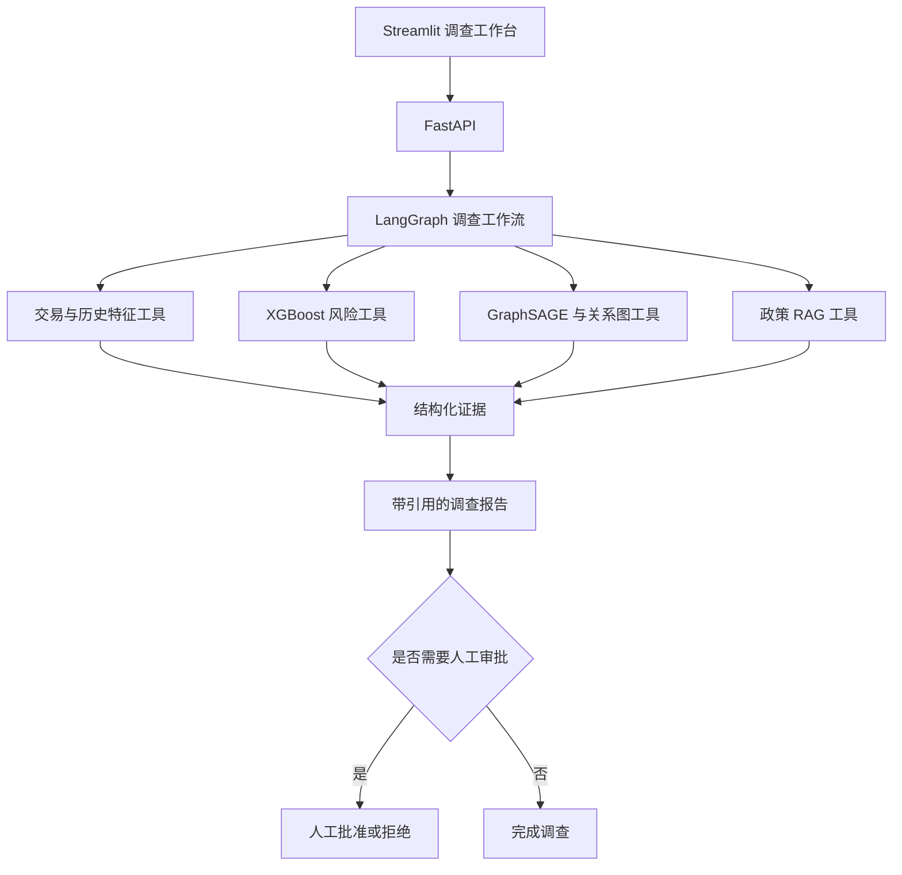

# GraphRisk-Agent 总体项目计划

> 文档状态：执行中。Stage00～08工程完成，Stage09原路线及5B工程完成；增强基线质量Pass、GNN增量Fail/不晋级；Stage09本人学习/人工实用性Pending，整体In Progress。Stage10于2026-10-17启动，路线0～6工程完成；新真实质量Fail（6/10）；路线7材料/机制完成、本人验收Pending；路线8 Planned；新检出有缓存复现通过，冷缓存/原始重训未测。
> 当前版本：v1.1
> 建立日期：2026-09-21  
> 计划周期：原Week0+16周；Stage09路线5B追加约2.5～3周，后续交付顺延
> 每周投入：20～24 小时

> 2026-10-16 跨聊天交接：[当前状态、工作区与后续 GNN 检索约定](docs/plans/stage-09-cross-chat-handoff.md)。原 Stage09 路线6～8工程已完成；2026-10-17用户启动Stage10交付。已确认的最多一周关系模式检索专项仍未启动，须另行指令，不改变5B不晋级结论，也不增加当前Stage09验收条件。

## 1. 项目使命

GraphRisk-Agent 是一个面向求职展示的智能风控调查系统。项目使用交易欺诈作为业务场景，重点证明开发者能够设计、实现、评估和部署一个可靠的 LLM Agent 应用。

系统以交易为主要调查对象。用户输入 `transaction_id` 后，系统应调用结构化数据、风险模型、关系图和政策知识库，生成带证据与引用的调查报告，并将高风险处置交给人工审批。

本项目服务于以下求职方向：

- LLM 应用算法工程师；
- Agent 算法工程师；
- RAG 算法工程师；
- AI 应用工程师；
- 知识图谱／大模型应用算法工程师。

项目的核心叙事是：

> 构建一个可以可靠调用 XGBoost、GraphSAGE、SQL、图查询和 RAG 工具的风控调查 Agent，并使用系统化评估证明它的有效性和边界。

## 2. 最终用户体验

用户在调查工作台中输入一笔交易编号。系统依次完成：

1. 查询交易与历史特征；
2. 获取 XGBoost 风险分数；
3. 获取 GraphSAGE 图风险分数；
4. 查询相关卡片、设备、邮箱域和地址；
5. 检索适用的风控政策；
6. 整理模型证据、图证据和政策证据；
7. 生成结构化调查报告；
8. 对高风险建议请求人工批准。

## 3. 成功标准

以下条件全部满足，项目才算完成：

1. 新环境可以按照 README 安装并运行核心 Demo；
2. 时间切分和历史特征具有自动化测试，能够证明不存在已知的未来数据泄漏；
3. 增强XGBoost、GraphSAGE与受控简单融合在相同时间集合公平比较并给模型决策；GNN允许退出评分，历史已观察测试不称全新盲测；
4. 至少建立 50 个 Agent 评估案例；
5. 评估报告覆盖工具选择、参数生成、证据引用、任务完成、失败恢复、延迟和调用成本；
6. 可以现场完成一次带模型证据、图关系、政策引用和人工审批的交易调查；
7. 代码、配置、测试和文档可以公开，原始受限数据、密钥和本地模型文件不会进入 Git。

## 4. 范围边界

### 4.1 必须完成

- 可复现的 Python 工程和自动测试；
- IEEE-CIS 或替代数据的时间切分与历史特征管线；
- XGBoost 基线；
- GraphSAGE 基线；
- 简单模型融合与统一评估；
- 结构化、无 LLM 依赖的调查工具；
- 带引用的政策 RAG；
- 受控 LangGraph 工作流；
- 超时、重试、失败恢复和人工审批；
- FastAPI、Streamlit Demo 和 Docker 化；
- Agent 评估集与评估报告；
- 英文主 README、中文说明和面试材料。

### 4.2 达标后增强

- PostgreSQL 与 pgvector 正式集成；
- Neo4j 图查询和可视化；
- API 模型与本地量化小模型对比；
- 独立 GraphRAG 企业知识助手；
- MLflow 模型注册与更完整的可观测性。

### 4.3 优先删减

进度落后时，按以下顺序删减：

1. Feast；
2. 异构 GNN；
3. 复杂模型融合；
4. 500～1000 并发压测；
5. 完整本地 LLM 适配；
6. 高级监控面板。

## 5. 数据原则

- 主数据优先使用 IEEE-CIS Fraud Detection；
- 无法及时取得数据时，使用公开小型数据或合成交易数据打通完整管线；
- 训练、验证和测试严格按照 `TransactionDT` 排序切分；
- 所有历史统计只能使用当前交易发生前的信息；
- 图训练数据不得包含验证集和测试集中的未来关系；
- IEEE-CIS 中不存在可直接解释为真实用户的完整实体；
- 可以使用明确记录的规则生成 `identity_key`，但不得声称它是真实用户 ID；
- 合成政策、案例和身份信息必须清晰标注；
- 原始 IEEE-CIS 数据不提交 Git。

## 6. 模型与 Agent 原则

- PR-AUC 为主要离线模型指标，ROC-AUC、Recall、Precision、F1、Recall@Top-K 和 Precision@Top-K 为辅助指标；
- 模型比较必须使用同一时间测试集；
- 项目不预设 GNN 一定优于 XGBoost；
- 2026-10-09新增路线5B：增强XGBoost最低基础ROC-AUC目标0.80、0.90探索；相对增强基线的融合AP绝对+0.005、Recall@Top1%相对+5%与三折/三种子稳定性决定GNN晋级，基础目标与图增量分别验收；
- GNN没有可信收益可退出评分，保留确定性关系查询与负实验；覆盖率、模型质量和Agent报告质量分别记录；
- Agent 的每个工具必须有明确输入、结构化输出和独立测试；
- Agent 使用有限状态工作流，在受控工具集合中做选择；
- 确定性检查负责验证工具、参数、引用和工作流结果；
- LLM-as-a-judge 只作为回答质量的辅助评估；
- Agent 负责调查、解释和建议，不自动执行封禁等高风险操作；
- 高风险建议必须进入人工审批节点。

## 7. 冻结技术栈

| 层次 | 技术 |
|---|---|
| Python | Python 3.11、uv |
| 数据 | Parquet、DuckDB、PostgreSQL |
| 向量检索 | pgvector，通过统一 Retriever 接口封装 |
| 机器学习 | scikit-learn、XGBoost |
| 图学习 | PyTorch、PyTorch Geometric、GraphSAGE |
| 图查询 | 初期本地图结构，后期 Neo4j |
| Agent | LangGraph |
| API | FastAPI、Pydantic |
| 前端 | Streamlit |
| 实验管理 | MLflow，精简使用 |
| 测试 | pytest、Agent evaluation suite |
| 部署 | Docker Compose、GitHub Actions |

技术栈发生变化时，必须先在对应阶段文档中记录原因、替代方案和影响；跨阶段变化同时更新本文档。

Windows 测试运行使用仓库根目录的 `conftest.py`，按实际操作系统账户将 pytest `tmp_path` 放到 Git 忽略的 `artifacts/pytest-<account>/`。这避免沙箱账户与用户终端因继承同一个 `USERNAME` 而争用默认 `%TEMP%\pytest-of-*`；不改变测试内容或验收阈值。

2026-10-07 补充跨阶段存储约束：每个新的 PowerShell 项目终端先执行 . .\scripts\enter_project_env.ps1，将项目子进程的 TEMP/TMP、pip 缓存、uv 缓存与托管 Python 放在仓库内。设置仅影响当前进程及其子进程，不强制修改独立子项目的虚拟环境路径，不迁移 Docker/Ollama/Codex，也不改变 Windows 全局环境。C 盘空间审计及保守清理步骤见[存储检查](reports/storage-audit-20261007.md)。 同一初始化脚本保留已有 NO_PROXY 条目并追加 localhost、127.0.0.1、::1、host.docker.internal 和 db，避免本地模型/API 请求被继承的代理转发；不改 Windows 系统代理。

## 8. 阶段路线

| 阶段 | 时间 | 主要结果 | 文档 |
|---|---|---|---|
| Stage 00 | Week 0 | 环境、磁盘和数据门禁 | [Stage 00](docs/plans/stage-00-preflight.md) |
| Stage 01 | Week 1～2 | 工程骨架与时间正确的数据管线 | [Stage 01](docs/plans/stage-01-foundation-data.md) |
| Stage 02 | Week 3 | XGBoost、统一评估和预测 API | [Stage 02](docs/plans/stage-02-ml-service.md) |
| Stage 03 | Week 4 | 确定性调查工具与无 LLM 工作流 | [Stage 03](docs/plans/stage-03-investigation-tools.md) |
| Stage 04 | Week 5 | GraphSAGE 与图查询工具 | [Stage 04](docs/plans/stage-04-graph-risk.md) |
| Stage 05 | Week 6～7 | RAG、LangGraph、失败恢复和审批 | [Stage 05](docs/plans/stage-05-rag-agent.md) |
| Stage 06 | Week 8 | 可演示 MVP 与首份 Agent 评估报告 | [Stage 06](docs/plans/stage-06-mvp.md) |
| Stage 07 | Week 9～10 | 评估 v2、PostgreSQL 持久恢复与 pgvector 政策检索 | [总纲](docs/plans/stage-07-hardening-platform.md) · [实现路线](docs/plans/stage-07-implementation-roadmap.md) · [学习路线](docs/plans/stage-07-learning-roadmap.md) |
| Stage 08 | Week 11～12 | 本地模型与小额 API 同集对照；独立模拟企业 GraphRAG | [总纲](docs/plans/stage-08-local-model-graphrag.md) · [实现路线](docs/plans/stage-08-implementation-roadmap.md) · [学习路线](docs/plans/stage-08-learning-roadmap.md) |
| Stage 09 | Week13起；5B追加约2.5～3周 | 真实Agent、强表格基线、GraphSAGE增量/覆盖与持续质量 | [总纲](docs/plans/stage-09-quality-operations.md) · [实现路线](docs/plans/stage-09-implementation-roadmap.md) · [学习路线](docs/plans/stage-09-learning-roadmap.md) · [5B实施](docs/plans/stage-09-route-5b-model-enhancement.md) · [5B学习](docs/plans/stage-09-route-5b-learning.md) |
| Stage 10 | 2026-10-17启动；约44小时主动投入 | 性能/当前真实小样本、演示、复现和求职材料 | [总纲](docs/plans/stage-10-delivery-career.md) · [实现](docs/plans/stage-10-implementation-roadmap.md) · [学习](docs/plans/stage-10-learning-roadmap.md) |

后续工作须满足其实际依赖的工程门禁；本人学习/人工复核独立Pending不代签。用户于2026-10-17在Stage09工程通过后启动Stage10交付整理，前序个人待完成项继续跟踪，并约束最终项目结项。

## 9. 每周时间预算

| 工作 | 每周时间 |
|---|---:|
| 实现、测试和调试 | 12～14 小时 |
| 学习当前任务需要的知识 | 4～5 小时 |
| 阅读并解释关键代码 | 2 小时 |
| Agent 评估、失败复盘和文档 | 2 小时 |
| SQL、算法或面试表达 | 1 小时 |

学习内容由本周交付倒推。禁止为了“先学完”而长期推迟可运行交付。

## 10. 文档维护规则

本文档是项目目标和跨阶段边界的唯一事实来源。阶段细节以 `docs/plans/` 中的对应文件为准。

每次范围、架构、数据、指标或进度发生变化时：

1. 先更新当前阶段文件中的“计划变更”和“决策记录”；
2. 如果变化影响其他阶段，再更新本文档；
3. 在代码提交中同时包含相应文档修改；
4. 只有附有测试、报告、截图或可运行命令等证据时，任务才能标记为完成；
5. 阶段结束时填写实际结果、未完成项、遗留风险和下一阶段输入。

详细流程见 [阶段文档索引](docs/plans/README.md)。

路线 7 于 2026-09-29 用独立 Compose 完成 pgvector/PostgreSQL、API、工作台和宿主 Ollama 的真实容器演练：16 条政策向量、同运行 ID/哈希跨 API 容器恢复、DB 断连 503 与恢复、down/up 后命名卷保留，镜像/挂载/响应/日志数据边界检查及 339 项全量测试通过；见 [路线 7 报告](reports/stage-07-route-7-compose-faults.md)。Stage 07 路线 8 总验收已通过；见 [逐项报告](reports/stage-07-route-8-acceptance.md) 和 [中文演示](docs/data/stage-07-demo-guide.md)。

Stage 08 于 2026-09-29 完成规划及路线 0 门禁（339 项测试、50/50、15/15、独立包隔离安装）；路线 1 已通过固定千问离线协议、安全输出及费用预留门禁（395 项测试、50/50、15/15）；路线 2 已补齐资源测量，路线 3 本地/DeepSeek 对照完成、正式账单待对账，路线 4～7 工程已验收，路线 8 演示已实现、总验收待真库回归与账单对账；见[总纲](docs/plans/stage-08-local-model-graphrag.md)、[实现路线](docs/plans/stage-08-implementation-roadmap.md)及[学习路线](docs/plans/stage-08-learning-roadmap.md)。基于用户本地优先与小额 API 的偏好，将历史“API 为主”假设更新为本地优先、托管对照；路线 0 已选定千问北京固定快照 qwen-plus-2025-12-01，用户授权上限 100 元、停止线 80 元；路线 0 的未配置状态为历史，当前 DeepSeek 20 案已通过、正式账单待对账。见[门禁报告](reports/stage-08-route-0-preflight.md)与[实验合同](docs/data/stage-08-experiment-contract.md)。GraphRAG 采用独立原创模拟 IT 知识语料、带出处关系边和单独冻结集，不能以 Stage 07 的欺诈交易图替代。

## 11. 当前已知条件与风险

- 仓库已完成 Stage 00～07 的工程门禁；Stage 07 路线 0 通过前置与 PostgreSQL/pgvector 临时探针，路线 1 冻结 15 个新挑战，路线 2 完成请求 ID/工具轨迹/安全审计，路线 3 冻结持久化合同，路线 4 用真 PostgreSQL 完成同运行 ID 的跨实例待审恢复；旧内存模式仍诚实返回 410；
- 仓库内 Python 3.11、uv 锁文件和本地虚拟环境已可用；
- Docker Desktop 和 Stage 06 容器已可用；PostgreSQL 17 已接入持久运行/审批/费用并通过真库演练；pgvector 0.8.6 已接入显式政策检索候选并完成真库/同集质量验收；Neo4j 未接入；
- GPU 为 RTX 2060 6GB，适合受控规模 GraphSAGE 和量化小模型实验；
- 内存约 16GB，数据处理需要避免复制完整宽表；
- Stage 00 验证时 E 盘约有 47.52GB 可用空间，后续仍需监控模型与本地 LLM 占用；
- IEEE-CIS 五个官方 CSV 已下载到 `data/raw/ieee-cis/`，canonical adapter、全量特征管线和真实数据基线均已验证；
- LLM API 总预算控制在 100～200 元，实验必须记录 Token 和估算成本。

## 12. 当前状态

Stage 00 已于 2026-09-21 完成：

- Git 仓库已经初始化；
- 仓库内 Python 3.11.16、uv 锁文件和虚拟环境可用；
- smoke test 为 2/2 通过；
- E 盘约有 47.52GB 可用空间；
- 数据入口、保存路径、许可处理、来源记录和合成后备方案已经文档化；
- Docker、PostgreSQL 和 Neo4j 按计划后置。

Stage 00 完成时 IEEE-CIS 尚未下载，因此项目使用合成数据契约继续推进。用户随后已通过自己的 Kaggle 账户取得数据；真实数据 adapter 和重跑完成前不得报告真实数据集模型指标。

Stage 01 已于 2026-09-21 完成：

- 建立可安装的 `src` layout Python package；
- 建立配置、结构化日志和 canonical transaction contract；
- 使用 DuckDB 完成数据校验、标准化和 Parquet 输出；
- 实现 1 小时、24 小时和 7 天严格历史窗口特征；
- 完成 70%/15%/15% 时间切分；
- 建立 13 项测试，包括同时间事件隔离和未来交易不改变历史特征；
- 5,000 行合成管线连续运行两次得到相同 SHA-256 产物；
- 详细验证记录位于 `reports/stage-01-validation.md`。

IEEE-CIS 原始数据已于 2026-09-21 放入 `data/raw/ieee-cis/`，adapter 随后完成全量接入验证。合成数据与 IEEE-CIS 指标分别保留，不混合作为同一组实验结果。

Stage 02 已于 2026-09-21 完成：

- 使用相同时间切分训练 Dummy、Logistic Regression 和 XGBoost；
- 以验证集 PR-AUC 选择 Logistic Regression 为 champion，测试集只用于最终报告；
- 统一报告 PR-AUC、ROC-AUC、Precision、Recall、F1、Top-K 与单条预测 P95 延迟；
- 使用本地 MLflow SQLite 后端保存三个完成的实验运行；
- 建立 `/health`、`/model/info` 和 `/risk/predict` FastAPI 接口；
- 25 项自动化测试全部通过，并用真实 Uvicorn 进程验证成功与错误响应；
- 详细证据位于 `reports/stage-02-validation.md`。

Stage 02 的原始指标来自合成数据；后续真实数据重跑选择 XGBoost 为 champion，验证集/测试集 PR-AUC 分别为 `0.1736`/`0.1522`。真实数据 API 预测成功，但单请求约 `802ms`，需要后续优化。风险等级阈值和模型概率尚未做业务校准。详细真实数据证据位于 `reports/ieee-cis-adapter-validation.md`。

Stage 03 已于 2026-09-23 完成：

- 建立五个类型化调查工具和稳定错误分类；
- 实现交易事实、严格历史特征、XGBoost 分数与历史共享实体查询；
- 模型工具检查调查/训练数据源、serving 路径和 champion metadata；
- 图风险邻居在 Stage 04 前明确返回 `unavailable`，不伪造图证据；
- 建立固定顺序的无 LLM 工作流、确定性报告、证据绑定和独立审计；
- 74 项聚焦测试和 105 项全量测试通过；
- 两次真实 IEEE-CIS 调查报告哈希一致，失败恢复与受限文件门禁通过；
- 详细证据位于 `reports/stage-03-validation.md`。

Stage 04 的工程门禁已于 2026-09-24 完成，路线 0～7 的证据见 `reports/stage-04-validation.md`。其中路线 0～3 的基础结果为：

- 锁定 torch/PyG，在 CPU 与 RTX 2060 CUDA 上运行最小 `SAGEConv`，通过环境、同源配置与上游产物门禁；
- 建立五类节点、严格历史局部图、训练 ID 拟合的交易特征 encoder，以及十笔交易的固定节点/边 fixture；
- 未来、同时间、占位实体和标签不能改变较早目标图；图 fixture 为 13 个节点、16 条逻辑边；
- 路线 1 时全仓库 137 项测试通过；证据位于 `reports/stage-04-route-0-preflight.md` 和 `reports/stage-04-route-1-schema-time.md`；
- 路线 2 随后完成 DuckDB 列投影与源一致性校验、时间倒排索引、稳定节点/边表及可校验 manifest；
- IEEE-CIS 50k/10k/10k 目标集合可重复构建，索引 511,959 笔历史交易，manifest 逐字节一致；峰值 RSS 抽样约 1,366 MiB；
- 全仓库 146 项测试通过；路线 2 证据位于 `reports/stage-04-route-2-artifacts.md`；
- 路线 3 在 RTX 2060 上完成 50k 训练，最佳 epoch 2、第 6 轮早停，验证/测试 PR-AUC 0.178343/0.103733；模型可在 CPU 重新加载；
- 同种子合成实验与正式 CUDA 训练的每轮指标一致；全仓库 156 项测试通过，详见 `reports/stage-04-route-3-training.md`；
- 路线 4 在同一 50k/10k/10k ID 集合上比较受控 XGBoost、GraphSAGE 与验证集选择的融合；测试 PR-AUC 分别为 0.129566、0.103733、0.128175，融合没有超过受控 XGBoost；
- 路线 5～6 将版本化 GraphSAGE 风险邻居、受控融合分数与证据绑定接入五工具确定性工作流；图不可用或目标未覆盖时仍保留其它调查证据；
- 路线 7 的 54 项聚焦测试、166 项全量测试、真实双运行报告哈希、两类失败恢复、离线锁文件、构建和受限文件门禁通过；
- Stage 04 工程状态为 `Done`，个人学习路线仍需学习者自行完成自测；政策 RAG、LLM Agent 和人工审批仍属于 Stage 05 及后续阶段。

Stage 05 于 2026-09-24 开始路线 0：已冻结同源配置、显式政策适用日期、报告/审计边界和本阶段 24/30 元 API 停止/总额阈值，复验 Stage 04 正式调查五工具均为 `ok`。同日用户安装 LangGraph 和 Ollama 后，路线 0 完成：LangGraph 1.2.12 fake 状态图、本地 `qwen2.5:0.5b` 的 digest 核对与真实结构化 JSON smoke 均通过；聚焦 22 项、全量 188 项测试通过。它只证明本地能力可用，尚未实现政策 RAG、正式调查 Agent 和人工审批。路线 0 的完整证据与限制见 `reports/stage-05-route-0-preflight.md`。

路线 1 同日完成 8 份原创模拟政策、来源与公开展示标记、半开生效区间和 16 个章节段落位置。共享设备 V1/V2 在 2026-07-01 切换，可信设备例外故意与 V2 冲突；连续两次导入的 manifest 哈希相同。聚焦 30 项、全量 200 项测试通过。路线 2 才构建检索索引和 `chunk_id`；路线 1 的语料不构成真实企业制度。详见 `reports/stage-05-route-1-policy-corpus.md`。

Stage 05 于 2026-09-26 完成工程门禁：8 份模拟政策、16 个稳定 chunk；冻结集 TF-IDF/本地 embedding Recall@3 均为 1.000，17/17 个受控 Agent 案例通过。预选 IEEE-CIS 测试交易 `3488959`（train/validation/test 出现次数 0/0/1）走通五工具、真实本地模型派生报告 `verified`、政策原文/版本/日期/哈希引用核对、待审批→人工拒绝、无政策拒答和模型断连有限重试。全量 260 项测试及构建门禁通过。旧 `same-id-v4` 比较绑定历史 checkpoint，现保留为历史产物并新建当前 `stage05-route8` 运行；受控同 ID 测试 PR-AUC 为 XGBoost 0.129566、GraphSAGE 0.085999、融合 0.118062，不能宣称图模型提升。真实小模型曾误写不确定性枚举，现由 Stage 04 权威状态裁决，交易/证据/引用/动作仍严格校验。完整证据见 `reports/stage-05-route-8-acceptance.md`；个人学习自测仍由学习者完成，Stage 06 开始 API、工作台、容器演示与 50 案例。

Stage 06 路线 0～3 于 2026-09-26 完成工程门禁：单进程 FastAPI 复用 Stage 05 运行器、费用账本和 LangGraph 检查点，调查创建/读取、依赖就绪以及人工审批 GET/POST 均已落地。审批提交绑定运行、会话、交易与冻结报告哈希；批准/拒绝和可选备注只进入独立审计，完全相同的重试幂等，冲突与过期明确失败。审批默认 30 分钟、调查记录默认 24 小时；`reviewer_id` 是未认证演示字段，外部动作始终为 0。真实 IEEE-CIS held-out 样本经本地 HTTP 完成 `verified/pending → rejected`，全量 287 项测试通过；详见 `reports/stage-06-route-3-approval-api.md`。

Stage 06 路线 4 同日完成工程门禁：Streamlit 单页工作台只调用 FastAPI，显示交易、XGBoost、GraphSAGE/融合、历史邻居、模拟政策原文出处、不确定性及受控工作流审计；人工批准/拒绝和备注由 API 持有。页面只保留当前 `run_id`，刷新使用 URL 中的运行 ID 重读，不重新创建调查。真实 held-out `3488959` 在浏览器完成 `verified/pending → rejected`，备注及刷新后终态可见，外部动作 0。5 项界面测试和内存限制下分组 64+228 项测试通过；整套一次运行因 DuckDB fixture 遇到本机内存不足未通过，详见 `reports/stage-06-route-4-streamlit-workbench.md`。路线 5 已落地一键本地启动、受限宿主 Ollama 地址与 Compose 静态定义；真实 API/工作台就绪、held-out 调查和人工拒绝均通过，全量 302 项测试与离线包构建通过。Docker Engine 恢复后，现有镜像通过 Compose 容器启动/健康、真实调查与人工拒绝、镜像扫描和关闭验收，路线 5 已完成；路线 6 的 50 案（旧 17+新 33）与三个固定本地样本已评估，路线 7 已复核本地与 Compose 的真实交易调查、三类证据、政策引用、拒绝审批、无政策/受控模型断连、50/50 固定案例、305 项全量测试、离线锁与包构建、Git/镜像边界；Stage 06 工程状态为 `Done`，个人学习自测仍由学习者完成。固定交易有图分数但无合格历史邻边，不能说成展示了真实关系边；新机器须自行准备受限数据和工件。容器、评估和总验收分别见 `reports/stage-06-route-5-local-compose.md`、`reports/stage-06-route-6-agent-evaluation.md`、`reports/stage-06-route-7-acceptance.md`。

Stage 07 路线 0 于 2026-09-27 通过前置门禁：现有锁文件、305 项全量测试、冻结 50/50 与三条真实本地样本复跑通过；Stage 06 本地和 Compose 的 API/工作台再次就绪。临时 PostgreSQL 17.11/pgvector 0.8.6 容器完成扩展 SQL、向量查询和 PostgresSaver 检查点往返；候选 Python 依赖与镜像摘要已固定在 `reports/stage-07-route-0-preflight.md`。路线 1 于 2026-09-28 冻结 15 个机制不同的 v2 挑战与 3 个开发案，旧 50 哈希不变，引用/审批错绑变异可被评分器抓到；真实 API 重启探针为已观察 0/1 通过、另 14 案未运行，全量 310 项测试通过。详见 `reports/stage-07-route-1-failure-contract.md`。路线 2 同日贯通服务端请求 ID、工具/Agent/审批受限日志和审计字段；固定 held-out 真实本地调查 `verified → rejected` 有 5 工具、6 Agent 节点和 2 次依赖尝试关联。新冻结集已观察 1 通过/1 失败/13 未运行，316 项全量测试通过；证据见 `reports/stage-07-route-2-request-trace.md`。路线 3 于 2026-09-28 冻结 checkpoint-first 发布、费用/审批幂等、迁移和 P01～P15 故障合同；路线 4 同日完成 PostgreSQL 运行、检查点、审批决定、费用与 TTL 的真库恢复，受限角色真实 held-out 跨实例拒绝和创建重放通过。冻结 v2 当前 2 通过、13 未运行，全量 329 项测试通过；证据见 `reports/stage-07-route-4-postgres-recovery.md`。路线 5 随后将固定 16 段 dense 索引导入 pgvector，受限角色真库查询、30 条固定案例本地/数据库候选完全一致、真实 held-out 调查 3 条向量政策命中；全量 334 项测试通过，详见 `reports/stage-07-route-5-pgvector.md`。默认 TF-IDF 保留。路线 6 于 2026-09-28 对旧 50 案和新冻结 15 案完整复测（50/50、15/15），同模型 digest 的三个固定真实本地样本复测通过，全量 336 项测试通过；来源篡改返回专用错误、PostgreSQL 部分图证据不开放审批，见 `reports/stage-07-route-6-agent-evaluation.md`。新开发集三案仍未运行，Compose 重建与故障演练已在路线 7 通过，路线 8 又复核工作台、真 DB/受控故障、Stage 06 默认回归、旧 50/50 与新 15/15、339 项全量测试和数据边界；个人 L0～L8 自测仍待学习者完成。旧隔离评估库 14/15 和首次浏览器自动化误操作均在总验收报告保留。

Stage08 路线 1（2026-09-29）：固定千问快照的离线协议适配、结构化输出/证据核验、费用预留账本与 fake HTTP 测试已实现；真实 API 未启用；最终 395 项测试、旧 50/50、新 15/15 通过。首次 Docker/数据库中断与隔离重跑记录见 [路线 1 验收](reports/stage-08-route-1-provider-contract.md)。用户确认 Stage08 完成后提醒 GraphSAGE 调整；Stage09 开头先补多交易真实 Agent 基线，再安排 8～12 小时主动工作的 GraphSAGE 诊断，训练运行时间另记。此项从可选监控展示中调整预算，不将图模型未胜基线等同于已经训练充分。
Stage08 路线 2（2026-09-30，待空闲复测）：固定唯一新候选 qwen3:4b，完成真实资源测量入口和空闲门禁。首轮真实 9 次请求：旧基线 8 次未过 schema，候选 cold 在游戏争用下超时；候选 warm/安全场景未测，不能宣称可行性验收成功。最终 402 passed、18 项数据库集成测试因 DSN 缺失跳过。见[路线 2 实测](reports/stage-08-route-2-local-model.md)；默认模型与 GraphSAGE 调整时点不变。

Stage08 路线 3（2026-09-30）：已完成 20 案冻结、隔离提供商评估及本地 0.5B/4B 各 20 案真实对照，整案均 0/20；详细失败和未运行分母保留。435 项通过、18 项数据库测试跳过；真实千问缺本机配置，路线 3 不关闭。路线 2 原参数空闲复测已补齐，资源测量完成但输出质量不合格。见[路线 3 报告](reports/stage-08-route-3-model-comparison.md)。GraphSAGE 的 Stage08 完成后提醒不变。

Stage08 路线 3 后续（2026-09-30）：用户选择 DeepSeek 作为实际托管对照；已补独立 API 适配及离线测试。真实预检发现密钥文件为空，尚未联网或计费；冻结 20 案不变、100 元授权/80 元停止线不变。DeepSeek 使用同输入的一 Token 付费计数校准，别名/指纹的版本保证弱于日期快照，差异如实记录；见[接入证据](reports/stage-08-route-3-deepseek.md)。路线 3 与阶段验收仍未通过。

Stage08 路线 3 最新结果（2026-09-30 16:05）：DeepSeek 鉴权及真实冻结 20 案 20/20 通过，共 20 校准+20 正式请求。费用保守估算 0.028383 元，正式账单待对账；路线 3 不提前标全验收完成。见[真实记录](reports/stage-08-route-3-deepseek.md)。历史空配置与网络失败保留，本轮不修改默认模型和 GraphSAGE 权重。

Stage08 路线 4（2026-09-30）工程验收完成：独立原创模拟 IT 语料 24 文档、58 片段、22 实体、40 关系和 30 冻结问答题；26 项独立来源/版本/路径/篡改测试通过，两次报告字节一致。根回归 451 passed / 18 skipped，根与子项目锁文件不变，没有模型调用和新增费用。详见[路线 4 验收](reports/stage-08-route-4-corpus-schema.md)。L4 个人学习独立记录，路线 5～8 与路线 3 账单对账仍未完成，Stage08 不提前关闭。

Stage08 路线 5（2026-09-30）：路线 5 工程验收完成：独立 BM25 / 两跳图 / 本地向量混合检索与隔离评估器已实现；58 段真实 embedding 重建两次字节一致，固定 30 问三模式共 90 条观测。22 题完整证据覆盖为 text 19、graph 20、hybrid 22，8 题两跳覆盖为 5/8、8/8、8/8；这不是生成答案正确率。51 项独立测试通过，根回归 451 passed / 18 skipped（缺 DSN）/ 1 warning。L5 个人练习待本人完成；路线 6～8、路线 3 正式账单对账及阶段总验收仍未完成，GraphSAGE 调整提醒保持在 Stage08 完成后。见[验收报告](reports/stage-08-route-5-retrieval.md)及[复现与学习练习](docs/data/stage-08-graphrag-retrieval.md)。

Stage08 路线 6（2026-09-30）：路线 6 工程验收完成：独立 6 步只读问答、统一引用清单、逐关系/日期/出处核验和拒答已实现；82 项独立测试通过，主项目 451 passed / 18 skipped（缺 DSN）/ 1 warning。最后一轮真实本地开发样例为 2/4 可回答案通过，另 2 案被核验器拒绝；4 个确定性拒答分支按预期停止。模型质量尚未全面验收，不将小样本或 fixture 当作 30 问成绩。路线 7～8 与路线 3 正式账单对账仍待完成，L6 个人自测独立记录。问答定位明确为“模型选择证据＋确定性事实模板”，不能当成开放式 LLM 自主推理。见[验收](reports/stage-08-route-6-grounded-answer.md)与[复现/学习](docs/data/stage-08-graphrag-answering.md)。GraphSAGE 在 Stage08 全部完成后再提醒专项诊断。

Stage08 路线 7（2026-09-30）：冻结 30 问 × text/graph/hybrid 形成 90 条首次真实本地问答观测（其中 60 次模型调用，余项确定性停止）；只读复核后可回答正确为 16/22、18/22、18/22，两跳 5/8、7/8、7/8，无答案与注入无动作三模式各 4/4，已发布假答/伪造引用/伪造关系为 0。hybrid 恰好通过预定门槛，与 graph 并列；冷启动失败和评分器复核前的原始记录均保留。91 项独立测试、根项目 451 passed / 18 skipped / 1 warning。见[路线 7 报告](reports/stage-08-route-7-graphrag-evaluation.md)与[L7 复现](docs/data/stage-08-graphrag-evaluation.md)。路线 8 与路线 3 正式账单对账未完成；GraphSAGE 专项仍等 Stage08 全部完成后提醒。

Stage08 路线 8（2026-10-02）：独立只读 Streamlit 演示、单独 demo 锁、干净 wheel 安装、双索引同哈希、两跳和无答案 CLI 已实测；路线 7 原始 90 条只读复核仍为 16/18/18，核心锁保持原 SHA256。核心项目 91 项合同测试、演示环境 3 项 UI 测试通过、主项目 451 passed / 18 skipped、Stage06 50/50。Docker Engine 未连接且无隔离 DSN，Stage07 15 案本轮 not_run；DeepSeek 正式账单仍待对账，故 Stage08 保持 In Progress。L8 练习和 90 秒讲述已提供，个人自测不代签。见[路线 8 逐项报告](reports/stage-08-route-8-acceptance.md)和[L8 指南](docs/data/stage-08-demo-and-interview.md)。GraphSAGE 提醒仍须等工程总验收完成后发出。

Stage08 隔离数据库收尾（2026-10-02）：修复 Stage07 调试 Compose 端口不可达问题：默认数据库仍仅在内部网络，调试覆盖文件额外接入独立非内部网络并仅绑定宿主 `127.0.0.1:15433`。独立测试库上的 18 项真库集成测试和 Stage07 冻结 15 案全部通过；根回归 470 passed / 0 skipped / 1 warning，Stage06 fake 50/50。DeepSeek 正式逐请求账单对账及 L8 本人复现尚未完成，Stage08 保持 In Progress；GraphSAGE 专项提醒继续等阶段工程总验收完成。详见[路线 8 验收](reports/stage-08-route-8-acceptance.md)。

Stage08 工程完工（2026-10-07）：用户导入的 DeepSeek 2026-09-30 小时汇总账单与 40 请求/全部 Token 精确匹配，Paid/CNY 实扣 0.0283512 元，内部上界 0.028383 元的舍入差额已解释。验收粒度明确修订为小时汇总，逐请求金额未知；结合原有路线 0～8 与隔离数据库/演示证据，工程 Done。个人学习自测独立记录。已提醒 Stage09 首先补多交易真实本地 Agent 基线，然后进行 GraphSAGE 实现、采样、特征消融与调参诊断；本次没有训练或新增模型调用。见[最终对账](reports/stage-08-route-3-deepseek.md)与[总验收](reports/stage-08-route-8-acceptance.md)。

2026-10-07 Stage01～08 跨阶段复测：根 452 passed/18 skipped（均为真库测试），独立核心 91 passed 与 demo UI 3/3、17/50 机制案例、真实数据/HTTP/本地模型调查、GraphRAG 两跳/拒答、构建与账单复核通过。Docker/WSL 当前 ERROR_NO_SYSTEM_RESOURCES，18 项真库、15 个持久化探针及 Compose 本轮未完成；既有工程 Done 不等于当前全环境复测通过。见[完整复测](reports/stage-01-08-recheck-20261007.md)。

2026-10-07 Docker 恢复后的跨阶段验收：真实 Engine 29.8.0、磁盘 D:\docker2\DockerDesktopWSL；新隔离数据库中根 470 passed/0 skipped，Stage07 冻结 15/15、Stage05/06 机制 17/17 与 50/50，独立核心/UI、真实本地调查及 Stage06/07 容器重启/断连/卷恢复均通过。项目终端加入本地 NO_PROXY；首次引擎中断和验收脚本错误保留。测试栈已关闭释放内存，镜像/卷保留，新增付费与训练均为 0。详见[恢复完整复测](reports/stage-01-08-docker-recheck-20261007.md)。单交易真实样例与 GraphSAGE 质量边界保持，Stage09 尚未开始。

2026-10-07 Stage09 规划更新：已撰写[实现路线](docs/plans/stage-09-implementation-roadmap.md)和[学习路线](docs/plans/stage-09-learning-roadmap.md)，阶段仍为 Planned。先路线0绑定实际模型/数据/Prompt版本，再路线1补30笔不同交易的真实本地基线（至少20笔真实生成尝试），之后路线2～4做GraphSAGE实现、采样、同特征对照、消融与有限调参；路线5同集重放，6～8完成CI、可观测/恢复与验收。总预算44h（实现验证31h、学习13h），GraphSAGE主动12h包含其中，运行等待另记。本次未训练或调用模型。已有测试指标被观察，固定方案复核不称全新盲测；工程、Agent质量、图增益、个人学习分开记状态。正式鉴权、多worker、生产备份移交Stage10边界审查，未实现不得宣称生产就绪。

2026-10-07 Stage09路线0工程门禁通过：161个配置/代码/数据/模型/政策输入冻结，主配置configs/stage05.yaml、TF-IDF/内存单worker、当前GraphSAGE与stage05-route8绑定；新增19测试含在新隔离库489 passed/0 skipped（18真库），旧机制50/50。合同明确历史test已观察、144生成、六候选/三种子/最多13新增GNN/6h墙钟及起始资源线。真实生成/embedding/训练/付费0，路线1～8未启动，见[路线0](reports/stage-09-route-0-preflight.md)与[合同](docs/data/stage-09-experiment-contract.md)。Docker曾HCS资源不足，正常start后设置显示C、旧D磁盘仍在；临时DB数据bind到E已关闭，不宣称旧D项目栈恢复。大构建前确认磁盘位置，L0本人自测独立。

2026-10-07 Stage09路线1工程证据完整：30不同验证交易全部真实本地生成，另3预定重复，0not_run、0fake质量案例、付费/训练0；19完整/10部分/1证据漏抄关闭。系统来源绑定29/30，但原始LLM uncertainty仅10/30；同一政策两个章节/单候选，不能当自由推理准确率。新增24测试、根495 passed/18未配DSN数据库skipped；原161基线文件核验无漂移。RAM门禁首次零调用失败保留，正常停止Docker释放内存后完成，Docker收尾仍停。所有原始响应/账本/AI交叉核对留E盘，人类至少10案核对及L1本人自测待完成，路线1不宣称全面Done；基线输入/真实调用/失败归因支持开始路线2 GraphSAGE实现审计。见[路线1报告](reports/stage-09-route-1-real-agent-baseline.md)和[评分合同](docs/data/stage-09-real-agent-evaluation.md)。

2026-10-07 Stage09 路线2工程审计通过：新增20测试，根515 passed/18缺DSN数据库skipped；手算/梯度/历史不同微型过拟合/原生早停恢复/时间边界通过。修复根归属、跨图边、单根和边索引校验，20真实验证图旧新logit差异0；295历史节点8项统计独立复算差异0，20/20真实历史梯度与扰动响应非零。原权重/图/Agent输出不改，旧冻结仅model.py预期漂移、新165输入冻结单独保存；真实训练/LLM/付费新增0。L2本人练习与路线1人类复核独立待完成，下一路线3采样与同特征基线，随后路线4正式消融/调参。 见[路线2报告](reports/stage-09-route-2-graphsage-audit.md)与[学习讲义](docs/data/stage-09-graphsage-audit.md)。本轮CPU验证不代表CUDA确定性/性能或全量模型无缺陷，旧GraphSAGE未胜基线仍待路线3～4诊断。

2026-10-07 Stage09 路线3工程完成：固定50k/10k目标、train-only 28维根特征/标签与参数冻结，XGBoost/MLP各一次真实训练；验证AP分别0.144610/0.160028，旧GraphSAGE同集合0.170545，业务50k/Stage02全量模型另表。cap5/cap10全120k局部图时间违规0，训练验证上下文0；验证允许更早无标签验证事件。较大采样新manifest/目录、同ID/encoder/根矩阵，平均验证历史13.9557→27.9106但尚未重训。保存模型10k重载评分差异0；新增17测试、根532 passed/18缺DSN数据库skipped。新GNN/LLM/付费0，L3本人学习与路线1人类复核独立待完成；路线4未开始，先补GNN预算后前向复现/重训消融，不由单次AP差异宣称结构增益。 见[路线3报告](reports/stage-09-route-3-sampling-baselines.md)与[学习讲义](docs/data/stage-09-sampling-baselines.md)。评分服务尚未切换新模型，整体Stage09仍In Progress。

2026-10-07 路线4工程完成：12次真实CUDA GNN（5消融/基础、6组合复用首组、2确认），旧checkpoint完整10k验证复现差异0；胜出candidate-4三种子平均AP 0.179247±0.009721，业务参照0.213027，晋级=False。验证先冻结决策，历史已观察测试一次复核，不以测试重选。25新测试、根557/18（18缺DSN），12权重各512验证根重载通过，失败构建与GPU探针记录/耗时保留。服务未切换、LLM/付费0；L4本人学习与路线1人类复核待完成，下一路线5决策接入与真实同集重放。 见[诊断报告](reports/stage-09-route-4-graphsage-diagnosis.md)和[学习讲义](docs/data/stage-09-graphsage-diagnosis.md)。

2026-10-08 路线5工程完成：显式stage09配置绑定验证决策，XGBoost主评分/candidate-4实验性图分数/无融合；30不同交易+3固定重复共33真实本地调用，18完整/10部分/2依据漏抄关闭，程序来源绑定28/30、原始uncertainty正确10/30，不能当推理准确率。30主评分不变，20图分数/14邻居顺序改变；10未覆盖保留。真实API错哈希409/拒绝200/动作0，记录真实投影AppTest与旧配置30工具快照回滚通过，追加生成0。全阶段66/144，新增训练/付费0；根586 passed, 18 skipped, 1 warning in 48.01s（18缺DSN），新增29机制测试。L5本人学习与路线1人类复核待完成，路线6～8未执行、Stage09仍In Progress。见[路线5报告](reports/stage-09-route-5-agent-replay.md)与[75分钟讲义](docs/data/stage-09-agent-replay.md)。

## 2026-10-08 路线 5A 插入与工程完成

按用户要求在路线5与6之间增加[Agent质量改进](docs/plans/stage-09-route-5a-agent-quality.md)，配套[学习路线](docs/plans/stage-09-route-5a-learning.md)。执行顺序5→5A→6，路线6须等待5A工程验收；旧路线5原始成绩不覆盖。主动工作追加8h（学习2.5h），阶段总计52h/学习15.5h。原全局144次预算不增加，本轮最多66次本地生成，不添加训练、下载或付费调用。

2026-10-08：路线5A[实现/学习计划](docs/plans/stage-09-route-5a-agent-quality.md)及[当前报告](reports/stage-09-route-5a-agent-quality.md)已保存。2026-10-08 路线5A工程验收完成：首轮开发15次失败保留，一次额外4B开发5/5后冻结；原30笔事实/引用与原始受限判断30/30，新10笔10/10，3重复报告一致。45不同交易、63次本地生成、Stage09累计129/144；图缺口保留，安全发布失败/付费/新训练0。根610 passed/18缺隔离DSN skipped/1 warning；真实API和记录真实投影AppTest通过。本人L5A与人工实用性复核待完成，路线6未开始；这不是自由文本推理或欺诈准确率验收。

## 2026-10-08：路线5A Docker补充复测

用户要求补充当前Docker验证。发现并修复Stage09主评分/质量报告入SQL后不能恢复的问题；保存请求/版本/已核验派生结果的三个哈希绑定，SQL仍不存原始graph_run，实时调查仍严格核验。新增12项机制测试，根640 passed、0 skipped、1 warning（含24项真库集成）。当前镜像/API/工作台启动、封存完整/图缺口报告恢复、错哈希/拒绝审批、Linux AppTest真实HTTP显示/刷新通过。

初次RAM2.078GiB不足先不生成；正常停止本次测试容器并重启Docker后回升至约4GiB，预先登记一次容器烟测。容器内使用真工具/检索/SQL/本地4B创建一笔调查，201/verified，实际一次模型POST、零重试，约12.16秒，1336/117 Token；25次采样最低RAM3.2319GiB，门禁未触发。移除仅用于测试的HTTP观察器、恢复正常入口并重启API后，新报告与rejected状态保留，外部动作0。3份报告工作台显示和刷新通过。

新增生成1、训练/付费0；原45笔独立质量分母与63次成绩不改写，当前路线5A合计64/66、Stage09累计130/144。原冻结JSON和修复前源文件历史不覆盖，两处运行源码变化单独登记；新核验脚本分别核对原评估与额外烟测，并检查总预算。当前只读复查用 `uv run --offline python scripts/check_stage09_quality_docker_recheck.py`，原freeze命令会按设计拒绝当前源码变化。本人学习、人工实用性复核和路线6仍待完成。[范围、证据与复现](reports/stage-09-route-5a-docker-recheck.md)。

## 2026-10-09：路线5B规划确认

用户完成Q1～Q11质询确认：固定IEEE-CIS、图作为增量信号、2～3周；先补强有效原始特征和XGBoost，再保持当前同构GraphSAGE扩量/有限调参，无效才进入v2，关系消融支持后比较异构模型。增强XGBoost的最低ROC-AUC目标由0.90调整为0.80，0.90保留探索；融合相对增强基线AP绝对+0.005、Recall@Top1%相对+5%、三时间折/三种子与至少两折正收益，允许GNN退出评分。门槛在正式同集合验证上衡量，不能把公开Kaggle成绩当本项目验收。

已新增[5B实施路线](docs/plans/stage-09-route-5b-model-enhancement.md)与[学习路线](docs/plans/stage-09-route-5b-learning.md)，八个小路线覆盖新合同、特征、强基线、同构扩量、条件增强、模型决策、完整原验证/测试覆盖与小规模prospective、验收。5B追加60h主动投入/学习18h，Stage09从52h调整为112h/学习33.5h，原路线6～8和Stage10顺延约2.5～3周。新GNN最多30次/12h/单次60min，最终确认预留9次，旧训练和生成预算不改。

当前C盘工作树用于源码/文档，大实验运行根在5B-0明确落到E盘仓库并绑定源码；不把大数据/缓存/权重复制到C盘。原历史test已观察，最多一次冻结后描述性复核，不称独立盲测。基础质量、图增量、覆盖工程和本人学习分别记录；本次只完成规划，新的训练、模型调用、服务切换和5B实现均未开始。

2026-10-09路线5B-0工程完成：[前置门禁与新合同报告](reports/stage-09-route-5b-0-preflight.md)。E盘Python3.11/锁文件同步检查、590,540笔原CSV/canonical/split ID-time核对、5A/Docker历史重评分通过。新三时间折、候选顺序、30次/12h GNN及12次XGB/3次MLP共享账本冻结，源码版本变化不重置预算；最终482输入哈希复核，96 passed/1符号链接skipped/1现有warning。资源最低线通过，全量峰值后续测；fit/新生成/付费0、旧生成130/144不变。路线1～7、基础ROC0.80、图增量及LB0本人学习仍待完成，Stage09保持In Progress。

2026-10-09路线5B-1工程完成：[原始特征与时间管线验收](reports/stage-09-route-5b-1-features.md)。完整590,540笔侧表含431原始字段+24派生，无标签输入；core38→63列、匿名敏感性方案454→871列，训练期填补/词表/筛选和250,979行分块转换通过。9目标/180历史值独立复算与未来/等时机制测试通过；75 passed/1旧符号链接skipped、493文件新冻结共享原零消耗账本。侧表约109MiB留E，构建196秒、进程峰值1.72GiB、可用RAM最低4.74GiB。旧数据/服务/权重/130次生成不变，新真实训练/调用/付费0；匿名字段供应方时点未知，fold-2/3预处理延后到最终方案冻结。下一5B-2增强XGBoost未启动，ROC0.80和图增量尚无新结果，LB1本人学习待完成。

2026-10-09路线5B-2工程完成：[增强XGBoost与公平对照验收](reports/stage-09-route-5b-2-baselines.md)。第一折250,979 train/25,098 inner，七模型同集合比较；按预定AP选择宽表x3，AP0.726914/ROC0.934365，core0.499383/0.866039，root28树/MLP AP0.164530/0.150673。七份完整预测重载与独立复算差异0，60真实根编码抽查差异0；90 passed/1旧符号链接skipped。内部读取内存限额及主机睡眠两次失败均封存，同参数/数据登记恢复，进程临时防自动睡眠结束释放。共9尝试（7完成/2失败），XGB8/12、MLP1/3、GNN0/30；XGB余3confirmation+1failure，旧生成130/144不变，外层/test/新增生成/付费0。全部大产物/缓存在E盘，三源快照沿用不可退款账本，服务切换安排在后续路线。内层成绩不代替三折0.80门禁/GNN增量，LB2本人待完成；下一5B-3可开始，Stage09仍In Progress。

2026-10-09路线5B-3工程完成：[GraphSAGE扩量与有限调参验收](reports/stage-09-route-5b-3-graph-expansion.md)。50k/150k/250,979与六参数共九次真实训练，统一25,098 inner，按AP选择g3（0.179596/ROC0.768844）；规模AP0.111899→0.155513→0.176763同时改变时间覆盖，不能单独归因样本量。276,077根向量、九份完整重载/独立指标复算差异0，92 passed/1旧符号链接skipped，新进程只读核验通过。150k与g2两次RAM门禁失败和同参数恢复保留，前2/13轮指标等价，三源快照沿用共享预算；GNN11/30尝试、9完成/2失败、6,400.69秒，九次确认保护后开发训练余约73分钟。5B共享20尝试（16完成/4失败），外层/test/新LLM/付费0，旧生成130/144不变，服务未切换。条件v2已触发，下一路线4先在剩余预算内冻结少量消融；三折质量/融合/服务覆盖/LB3本人仍待完成，Stage09保持In Progress。

## 2026-10-10：路线5B-4工程完成

[五组消融/条件增强报告、曲线与只读复现](reports/stage-09-route-5b-4-conditional-graph.md)已就绪：同250,979 train/25,098 inner，c4增强191维AP0.391845/ROC0.825771，匹配无边c5 AP0.374341/ROC0.829627；AP差+0.017504为单折探索，不能替代强XGB x3 AP0.726914的融合晋级。五真实组、六尝试；全276,077图重连审计通过，118相关测试通过/1旧符号链接skip，五权重完整新进程重载最大分数误差8.35e-7、指标复算差异0。c5原600秒失败不退款，同参数恢复前17轮五指标等价；实际源v2/v4归档、522源文件核验通过。

共享26尝试（21完成/5失败），GNN17/30、累计10,618.24秒、failure3/3用尽；九次确认9小时仍保护，开发训练余约3分钟。按预定AP选c4候选，融合网格已登记但未拟合；Hetero/R-GCN因预算与单折证据不足Deferred。默认评分服务未切换，外层/test/新LLM/付费0，旧生成130/144不变。下一5B-5融合/三折确认，再5B-6覆盖；LB4本人学习仍Pending，Stage09整体In Progress。

## 2026-10-10：路线5B-5工程完成，基线通过、图增量不晋级

固定c4-core-graph/x3、三时间折三种子确认工程完成，100 passed/1既有符号链接权限skipped/9 warnings，531输入登记（C265/E266）、各折独立预处理和时点图通过。12次真实确认（9图+3树）全部完成、新失败0；三折150,588外层平均XGB ROC-AUC0.905089/AP0.544367，最低0.80及均值0.90探索达到；三个alpha=1、融合ΔAP0、正收益0/3、两项95%区间[0,0]，GraphSAGE不晋级并退出主评分资格，保留关系与实验记录。88,581历史test描述性复核ROC-AUC0.903670/AP0.537789，测试前后决定完全相等；16次完整权重重放分数最大差8.64e-7≤1e-6，封存预测指标独立复算≤1e-12；25个真实日抽样/300项加权指标比较最大差2.22e-16。原生--check通过，共享38尝试（33完成/5既有失败）、RAM最低3.447GiB，新LLM/付费0、旧生成130/144不变。默认服务未切换，5B路线6覆盖/接入及7验收待执行，原路线6～8未开始；LB0～LB7本人学习和人工复核独立待完成，Stage09整体In Progress。决策/完整指标/失败与资源见[路线5验收](reports/stage-09-route-5b-5-confirmation.md)，150分钟实际练习见[LB5](docs/plans/stage-09-route-5b-learning.md)。质量决定先于历史测试封存；剩余额度不能在已观察外层/test后继续救分。新强基线接入和图退出的服务行为留5B-6，不能因本轮建了全历史测试图便宣称网站完整覆盖。

## 2026-10-15早期检查点：路线5B-6低内存试验（同日最终验收已替代）

[路线6检查点](reports/stage-09-route-5b-6-coverage.md)和[覆盖/低内存合同](docs/data/stage-09-coverage.md)已登记。用户要求降低内存，6GiB明确为建议余量，原训练门禁不变；独立CPU小样本试验采用1.5GiB系统余量/1.25GiB进程常驻上限。1,024笔真实四模型重放中原合并JSON加载越线保留；拆出树进程并另存UBJ后峰值407MiB、树分数差0，三个CPU图分数差≤2.68e-7、图阶段峰值917MiB。58项契约/关系/界面机制回归通过；无新训练/评分标签批次/LLM/费用，旧模型和默认配置未覆盖。完整177,162覆盖、新profile/API/prospective与旧审批兼容仍未验收，不能将样本通过写成路线6完成；本人LB6 Pending。

## 2026-10-15：路线5B-6工程验收完成

[完整验收与启动/只读复现](reports/stage-09-route-5b-6-coverage.md)：原验证/测试177,162笔图与分数全覆盖，fold2/fold3时间资格正确；5案真权重与重复3次、真实HTTP/工作台通过。33份旧记录、31份报告/审批hash不变，173项回归通过。主构建889MiB、独立树540MiB，进程重叠不能当成整机峰值；CPU推理独立1.5GiB/1280MiB合同，原训练3GiB不变。修复日历特征语义与旧API误导入，旧失败保留，新训练/标签批次/真实LLM/付费0。新配置显式选择，旧配置保留；实时数据库/容器与跨路线验收交5B-7，LB6本人Pending，原Stage09路线6～8未开始。

## 2026-10-15：路线5B-7工程总验收完成，交原路线6

[逐项验收及默认只读复现](reports/stage-09-route-5b-7-acceptance.md)：原生/归档核验0～6通过，当前完整回归806 passed/1旧符号链接skip/10 warnings（85.72秒），新增总核验器11 passed，24项真实PostgreSQL/pgvector无skip。缓存镜像只读加载当前源码，2笔不同模型折的真实工具/政策+夹具报告，错hash、拒绝审批、重启/断库恢复及真实HTTP工作台通过；Linux新事件真权重树差0、图均值差1.09e-8。旧失败/数据/训练与生成账本保留，新增真实数据fit/标签批次/真实LLM/付费0；测试后停止本轮栈释放内存，不删卷。5B-0～7工程完成，基线Pass、GNN不晋级、本人LB0～7 Pending；模型/数据卡和90分钟复盘模板就绪。下一原Stage09路线6分层回归与CI，原路线7/8及Stage10仍未完成，不能称全项目生产就绪。

## 2026-10-16：原路线6本地验收，远程Pending

[路线6报告](reports/stage-09-route-6-ci.md)：Windows/Linux各815 passed/1平台skip，24真库零skip与15机制探针、独立GraphRAG91+3、两个wheel、新镜像和47冻结文件Git往返通过。14项CI契约与8项换行检查已纳入；输入指纹a80fccc…，旧530闭包/账本不变，新真实数据fit/LLM/付费0。五类workflow已就绪；当前无Git远端/commit/run URL，远程not_run，路线6整体未关闭，L6本人Pending。原路线7/8及后续GNN检索未启动，Stage09仍In Progress；模型不晋级及全部旧负结果保留。

## 2026-10-16：本地 Git 版本收口完成，远程 CI 仍 Pending

[版本收口报告](reports/stage-09-git-closeout.md)：已从 bfbdc40 建立 `codex/stage09-version-closeout`，集成提交 `cc1da7dc92779c5260ea64721b313c8a52d43120` 保存 553 份工程文件，最终文档另作提交，最终 HEAD 与可恢复 Git bundle 哈希见本轮私有 acceptance。排除了秘密、交易原始数据、权重、缓存和本地助手状态；C 盘原始字节快照与 E 盘旧源码另存，E 盘 main 的 317 行原工作区状态不变。

从集成提交独立干净检出后，278 Python AST、47 冻结文件字节往返、Windows CPU 815 passed/1 符号链接权限 skip、真库 24 零 skip 及 15 受限账号机制探针、GraphRAG 91+3、两个 wheel 通过。复用锁定的 E 盘环境，源码导入来自检出；不宣称冷缓存安装或本轮新镜像验证。Git 行尾规范化后的检出指纹 b1009e… 与原始字节 a80fccc… 分开记录；最终文档提交不改变已测运行代码树。

无 Git 远端、无推送、无远程 run URL；下一步是核对远端和公开边界并补路线 6 远程证据。原路线 7/8 及后续 GNN 检索仍未启动。两个账本不变，原路线 6 的 435 份清单核对通过；新增真实训练/LLM/费用均 0，GNN 不晋级和本人学习 Pending 不变，Stage 09 整体仍 In Progress。

## 2026-10-17：原路线 6 真实 GitHub CI 工程验收通过

公开仓库为 [Zzfzys/GraphRisk-Agent](https://github.com/Zzfzys/GraphRisk-Agent)，分支 `codex/stage09-version-closeout`。[成功运行 39015632664](https://github.com/Zzfzys/GraphRisk-Agent/actions/runs/39015632664) 对应提交 `72c5078ac09849b1ca73b3ae3101389f6d99bea9`，六个任务全部 success：静态 278/冻结字节 47、CPU **816 passed / 1 平台 skip**、隔离真库 **24 passed / 0 skip** 与 **15/15** 受限账号机制探针、独立 GraphRAG **91+3**、两个 wheel 和实际无私有输入镜像构建/无网络 smoke。CPU 的 Linux skip 是 E 盘专用目录保护，不是缺 DSN；不同层分开计数，不冒充一次全量 pytest。

[首轮 39014968083](https://github.com/Zzfzys/GraphRisk-Agent/actions/runs/39014968083) 的两个 GraphRAG 启动失败保留。原因是相对解释器路径在子进程换目录后失效；已修复为相对调用者定位的绝对路径，并保留 virtualenv 符号链接。15 项 CI 契约及 91+3 独立本地回归通过，云端再次全绿。网站域名连接重置/超时后，通过 GitHub Git Data API 上传相同 Git 对象，逐 blob/tree/commit 核对 SHA，非强制更新分支；没有改写历史或系统网络。

收尾进一步显式配置 setup-uv 的 `cache-local-path`，避免 action 用 runner-temp 默认值覆盖仓库内缓存要求，并在现有 workflow 契约中断言。收尾提交也触发完整 CI；其最终 HEAD、run URL、任务日志和摘要哈希另存 `E:/GraphRisk-Agent/reports/generated/stage09/route6/20261017-github-ci-v1/acceptance.json`，不能把上面的 72c5078 运行误记到另一提交。

原路线6工程 Done，L6本人学习及人工复核独立 Pending；Stage09整体仍 In Progress，下一步等用户启动原路线7可观测/漂移/新库备份恢复，原路线8与后续GNN检索未启动。新真实数据fit/真实LLM/付费调用均0，两个旧账本和GNN不晋级决定保留；CI不是新增真实Agent质量成绩，也不代表生产部署验收。

## 2026-10-17：原路线7已启动，尚未验收

用户授权进入可观测性、漂移与安全恢复；[本路线报告](reports/stage-09-route-7-observability-safety.md)和configs/stage09_operations.json先登记合同。复用既有追踪、只读历史统计与冻结同模型漂移参考；故障/备份恢复限新隔离容器和另一个新库。训练、真实LLM、付费调用0，旧预算/负实验/报告不覆盖；L7本人Pending，原路线8及后续GNN检索未启动。

## 2026-10-17：原路线7本地工程验收通过，学习独立Pending

[路线7验收](reports/stage-09-route-7-observability-safety.md)与[操作/90分钟学习说明](docs/data/stage-09-operations.md)已就绪。白名单request/run/attempt和版本哈希日志、幂等计数、资源/超时分类、历史同集30笔分层统计、冻结历史漂移已实现；真实DB停机503/恢复200，pg_dump→另一个新空库pg_restore核对12表88行，待审续接/终态/幂等/预算/检查点/pgvector与受限角色通过，15/15故障恢复探针、6 canary零命中。本轮随机容器/匿名卷及密码文件已清理，私有备份保留至路线8人工复核后由用户决定。

最终本地839 CPU/1旧平台skip、26真库零skip与既有15受限探针、287AST/47冻结字节/两个wheel通过；旧530闭包、confirmation/177162覆盖行及两总账哈希不变，新真实fit/LLM/付费0。历史评分29/30→28/30仅复述、不宣称改善；历史三列PSI低于预设门槛，合成25%缺失等扰动另列，不推断准确率变化；冷/热未知。失败轮次保留，完整新代码/远程run以本轮私有acceptance绑定为准。

Stage09仍In Progress；L7本人Pending，原路线8及后续关系模式检索未启动。单worker、未认证reviewer_id、无实际封禁；生产鉴权、多worker、加密异地/全实例DR和生产RTO/RPO不在已验收范围。当前C盘71df源码、E盘环境/证据边界继续有效，不恢复使用E盘旧源码。

## 2026-10-17：原路线8已启动，验收进行中

已冻结stage09_final.json，开始核验历史真实质量/模型结论、当前API和工作台、适用的分层回归与个人复现交付。真实训练/生成/付费0，旧账本与负结果保留；本人学习/人工复核Pending，后续GNN检索及Stage10未启动。

## 2026-10-17：原路线8本地工程总验收通过，个人与质量限制保留

[原路线8总验收](reports/stage-09-route-8-acceptance.md)和[个人复现/150分钟学习](docs/data/stage-09-final-reproduction.md)、[本人模板](docs/data/stage-09-personal-review.md)交付。648历史绑定与原始评分/HTTP/选择/130调用重核通过，当前API真实HTTP+Streamlit AppTest回放两份不同真实历史报告，完整案拒绝/刷新/重复200/冲突409、图不足案无SQL审批及分数不补零、新API实例恢复无生成通过。新库只操作本轮lease，演练容器/匿名卷/密码文件清理，路线7备份仍私有保留。

最终本地851 CPU/1旧平台skip、26真库零skip、50/15模拟机制、290AST/47冻结往返/两个wheel通过；Streamlit入口和根conftest纳入源码指纹。路线7后端哈希不变、备份/12表88行/15恢复探针重新核对后复用；旧5B530闭包与两账本不变，新增真实训练/LLM/付费0。最终Git提交、推送及本提交自己的远程run单独保存 E:/GraphRisk-Agent/reports/generated/stage09/route8/20261017-final-v1/acceptance.json，不以旧CI替代。

工程Done；Stage09整体In Progress，L0～L8/LB及人工实用性待本人完成。5A的30回归/10新增受限判断复核通过，但当前5B增强配置没有新真实Agent质量成绩；GNN增量0、不晋级。原路线6～8工程已收口，GNN关系模式检索等用户另行启动，Stage10仍Planned；不增加生产承诺或抹去历史失败。

## 2026-10-17：Stage 01～09 跨阶段复测

[逐阶段复测报告](reports/stage-01-09-recheck-20261017.md)：当前4f9167e源码，主项目同一新隔离库全量877 passed/1 Windows符号链接权限skip/10 warnings（含26真库零skip），独立GraphRAG91+3；合计971测试通过，0失败/0错误，模拟50/15不混入总数。290AST/47冻结往返/两wheel、590540真实数据及18历史窗口独立重算、原模型API、177162覆盖/5案真权重/3重复、当前HTTP/工作台新库回放通过；旧交易2987100旧图覆盖外明确partial。90条GraphRAG旧结果及40次DeepSeek小时账单只读复核通过；530模型闭包/648历史绑定和旧恢复适用性通过。无新真实训练/LLM/费用，旧账本不改。Stage01～08工程仍Done，Stage09原路线工程Done但整体In Progress；GNN无增益不晋级、当前增强配置真实Agent质量未新增、本人与人工实用性Pending不变。后续专项/Stage10不自动启动，远程本提交状态另见私有证据。

## 2026-10-17：Stage 10 启动与路线 0 工程门禁通过

[总纲](docs/plans/stage-10-delivery-career.md)、[实现](docs/plans/stage-10-implementation-roadmap.md)、[学习](docs/plans/stage-10-learning-roadmap.md)、[合同](docs/data/stage-10-delivery-contract.md)、[七项台账](docs/data/stage-10-evidence-register.md)和[路线0验收](reports/stage-10-route-0-preflight.md)建立。计划44小时，其中学习13.25小时；路线0核对e443ed5与31证据绑定、复用971/1平台skip及其六项CI，未重跑大回归。旧文档字节归档，E盘本轮318行状态冻结；初轮用历史317行导致的外围门禁失败保留，未回滚用户文件。

路线1冻结当前增强配置10首次/2重复、14实际请求总上限与统计/预算运行器，路线2才实测；旧130/144账本不改，新增绑定追加台账，不自动重置或新增付费。后续3最终评估/卡片、4英中文说明/架构、5真实Demo、6干净复现、7求职/本人复核、8总验收。Stage10 In Progress，1～8 Planned，个人L0～L8 Pending；Stage09个人/人工实用性仍Pending，GNN不晋级不变。后续GNN检索专项不自动启动。

## 2026-10-17：Stage10路线1工程完成，真实实测尚未启动

[验收](reports/stage-10-route-1-measurement-contract.md)、[操作/学习](docs/data/stage-10-measurement.md)：冻结5验证+5测试、2重复，排除49匹配旧ID，参数/统计/质量分母先定；唯一追加台账绑定旧130/144，14上限含失败/重试，原生HTTP前持久预约，未知关闭后续发送。12模拟请求独立fixture，真实0；最终CPU898/1平台skip含47新增，计时资源/版本附录单独封存且真实执行入口待路线2登记。实现/学习/总纲/合同/证据台账同步；Stage10 0～1工程Done、2～8Planned，个人L1及前序学习/实用性Pending，GNN不晋级，后续检索未启动。

## 2026-10-17 路线2实测交接

[正式报告](reports/stage-10-route-2-real-measurement.md)：10笔首次真实受限判断6/10，门槛9/10未达，质量Fail；2次重复通过不补分。四笔错误输出均被拦截，unsafe0。实测工程已完成，Stage10整体仍In Progress，路线3～8和本人学习/人工实用性待完成。唯一台账142/144、剩2，无新训练/付费。当前新质量不能用历史5A40/40代替。

## 2026-10-18 用户决定：先交付，再开展 Agent 质量专项

用户决定保留路线2的首次6/10质量Fail、2次固定重复和4笔被拦截的原始记录，先继续Stage10路线3～8的交付工作，再单独安排Agent质量改进。工作顺序调整不放宽原9/10门槛，不把Fail改成Pass，也不将后续优化提前并入当前路线。Stage10最终整体状态仍须按全部验收条件据实判定。

当路线0～8工程交付及路线8总审计确有完成证据时，主动提醒用户启动后续Agent质量专项；不要以“先修好6/10”作为提醒前提。本人学习/实用性等Pending继续单列，工程收口不等于项目所有条件通过。当前下一步仍为路线3。

后续专项优先评审确定性事实由程序计算、LLM解释/判断单独评价的职责划分；规则填对不能算成LLM理解能力提升。实施前另行确定开发集、未见验证集和调用预算，原冻结失败题不重测救分。当前台账142/144、剩2次，不自动消耗、扩额、训练或付费；GNN关系检索专项仍待另行启动。

完成时提醒已登记在当前聊天及Stage10交接中，标识stage10-agent；本条仅记录后续顺序，不新增当前实验调用或改变旧验收结论。

## 2026-10-18 Stage10路线3工程验收完成

[最终成绩单](reports/stage-10-final-evaluation.md)、[路线3验收](reports/stage-10-route-3-final-evaluation.md)与[105分钟学习](docs/data/stage-10-evaluation-learning.md)交付；12项公开主张绑定版本/分母/证据，更新模型/数据卡并新增Agent卡和限制。16份已封存分数数组的17组指标重算、90条GraphRAG与12条Agent原始结果复判、40请求小时账单复核；没有新训练/模型调用/付费。原始账本与失败保留，当前质量仍6/10 Fail、GNN不晋级，个人L3/至少10案实用性Pending。

当前下一步路线4：英中文README、架构与启动说明。Stage10整体In Progress；Agent质量专项仍等路线0～8工程交付及总审计完成后提醒另行启动，提醒stage10-agent保持，不自动花剩2次预算。既有0e326b0的CI仅作运行代码历史证据，本轮文档核验不冒称新提交CI。

## 2026-10-18 Stage10路线4工程完成

[英中文首页](README.zh-CN.md)、[架构/时序](docs/architecture/stage-10-system.md)、[通用启动](docs/data/stage-10-startup.md)和[本机分离路径](docs/data/stage-10-author-workspace.md)交付，配套[路线4验收](reports/stage-10-route-4-readme-startup.md)与[90分钟学习](docs/data/stage-10-architecture-learning.md)。已有环境实际运行公开合成5000行流水线与50案fake机制CLI，核对帮助/配置/源码/链接；没有新环境安装、真实API/UI/数据库启动或模型调用。

当前路线0～4工程Done，5～8 Planned，下一路线5彩排与真实录制。本人L4/人工实用性仍Pending、Agent6/10 Fail/GNN不晋级/142余额剩2保持；stage10-agent提醒继续等待工程总审计完成，质量与GNN专项不提前启动。

## 2026-10-18 路线5图片交付验收

用户明确用图片代替录屏，路线5及总交付合同已据此修订；不再将视频缺失列为该路线阻塞。[图文脚本与L5](docs/data/stage-10-picture-demo.md)、[验收](reports/stage-10-route-5-picture-demo.md)和scripts/run_stage10_picture_demo.ps1交付。9张真实浏览器JPEG/本地图册在E:/GraphRisk-Agent/reports/generated/stage10/route5/20261018-pictures-v1/。

来源是路线2当前增强profile的case01成功/case04失败，均为已存首次结果；新memory审批实际拒绝并刷新，报告hash保持、外部动作0、失败仍503。自动HTTP/AppTest彩排9项行为检查通过；本轮无新模型/训练/费用，142/144剩2。代理图片不代签本人L5/人工实用性；Agent质量仍6/10 Fail、GNN不晋级。

当前路线0～5工程Done，6～8 Planned，下一路线6干净检出与双模式复现。stage10-agent提醒仍待工程总审计完成后触发；后续质量/GNN专项未启动。新增PowerShell编排单独hash登记，旧测量源码/结果不改。

## 2026-10-18 路线6新检出复现验收

[指南与L6](docs/data/stage-10-clean-reproduction.md)、[验收报告](reports/stage-10-route-6-reproduction.md)：从a3f1acc创建本地Git clone，610追踪文件核对；主项目及独立GraphRAG分别新建.venv，复用E盘下载缓存/managed Python，不复用旧环境。公开50案机制、合成5000行/特征通过；新环境CPU915通过/1平台symlink skip，独立核心91通过/3可选UI skip。

授权真实工件35输入/177162覆盖闭环、五工具、一笔冻结CPU权重通过，树差0/图差1.09e-8；实际HTTP/AppTest回放拒绝/刷新/幂等与原报告hash保持。新LLM/真实训练/付费0，三旧账本不变、142/144剩2。历史396文件严格字节校验因92文件LF/CRLF不同而改用显式封存快照，实际执行仍为新检出；未改旧结果/hash，辅助脚本失败保留。冷缓存、原始CSV重训、真库/镜像重跑未测，不冒称已完成。

当前路线0～6工程Done，7～8 Planned，下一路线7求职表达与至少10案本人复核。本人L0～L8/实用性Pending；Stage10整体In Progress、Agent6/10 Fail、GNN不晋级保持。stage10-agent提醒等工程总审计后触发；后续Agent质量/GNN检索专项不提前启动。应用代码/锁文件未改，本轮文档本地提交，不冒称新提交远程CI。

## 2026-10-18 路线7材料交付，本人验收Pending

[项目条目/讲述稿](docs/career/stage-10-presentation.md)、[20题与75分钟练习](docs/career/stage-10-interview-drills.md)、[十案本人指南](docs/career/stage-10-human-review.md)和[路线7进度报告](reports/stage-10-route-7-career-review.md)交付。所有简历指标可追溯，明确AI辅助与个人贡献待本人确认，不编造工作经历、生产收益或熟练程度。

私有目录E:/GraphRisk-Agent/reports/generated/stage10/route7/20261018-career-v1/，包含当前冻结首次10笔不同交易、6原成功/4被拦截、原模型字段/事实/政策原文、HTML/Markdown与空白意见/演练模板；不含两个重复，不新增模型调用。15项私有记录机制测试与实际浏览器模拟填写/草稿/失败/刷新通过，fixture导出不能混入本人记录，正式模板仍0/10 Pending。

用户已选择本轮本人填写、完成后提供路径；尚未收到不代签。路线7整体In Progress（材料/机制完成；十案实用性/自己的两段讲述、计时与追问待核验），路线8仍Planned；Stage09旧profile/缺图与其他个人学习独立Pending。三旧账本不变，142/144剩2，新LLM/真实fit/付费0。Agent6/10 Fail、GNN不晋级、阶段In Progress保持；提醒等既定工程总审计后触发，不提前启动质量/GNN专项。

## 2026-10-19：十案本人意见已接收，讲述与演练仍待完成

本人已提交十案JSON，来源/填齐检查通过；20份原结果和快照SHA核对一致，四个原失败保留。第6、7案后三项原误选通过，经本人在聊天中明确确认，另存v2改为无法判断；v1原件和其他意见/时间不变。私有记录在E:/GraphRisk-Agent/reports/generated/stage10/route7/十案复核/my-review-v2.json，核验在同级20261019-human-review-v1/。

按同一人的自报意见汇总：事实7通过/3无法判断；政策引用与未知边界各10无法判断；实用性1不通过/8无法判断/1不适用，无通过。接收为有限理解下的复核与可读性反馈，不证明专家审核、欺诈真值或实用性合格；第3案不适用保留，其理由不证明场景客观不适用。主要问题是JSON/字段难懂、出处和条件对照困难、失败案没有报告的原因不清楚。后续可读性/质量待办已登记，不在本轮自动修改模型或调用。

十案填写/意见接收这项完成；自己的Agent/GNN两段讲述及实际计时、至少六题回答、三个待补问题、AI辅助/个人贡献尚未收到，因此路线7与L7仍In Progress，路线8 Planned。其他Stage09/10本人项单独核验；原6/10 Fail、GNN不晋级、142/144剩2保持。三旧账本核对不变；新增模型生成/训练/付费0。本轮仅更新文档和私有核验，不宣称新pytest或远程CI。

## 2026-10-19：路线8工程总审计已启动

用户明确启动路线8，并将面试演练留待后续。路线7工程材料与十案意见接收已完成，个人讲述/计时/追问仍Pending；允许先收口工程，不代签本人学习或实用性。路线8开始核对七项标准、当前回归、旧证据适用性、公开边界、最终提交及其GitHub CI，尚未验收。

新证据E:/GraphRisk-Agent/reports/generated/stage10/route8/20261019-final-v1/；本机Docker引擎未连接，本地不声称真库/镜像重跑，相关层由本提交真实CI核对。原首次6/10 Fail、GNN不晋级、142/144剩2保持，不启动新模型生成/训练/付费。后续Agent质量改进和GNN检索专项均不提前实施。

## 2026-10-19：Stage10路线8工程交付版与最终CI门禁

[总验收](reports/stage-10-route-8-acceptance.md)和[最终交接/L8](docs/data/stage-10-final-handoff.md)就绪。当前代码本地CPU915/1平台skip、独立核心91/3可选UI skip、302解析/47冻结往返/两wheel、356旧证据绑定及当前HTTP/AppTest回放通过；四个DB文件未在本地执行，本机Docker未连接。最终版本验收须当前提交自己的六项GitHub CI成功，精确HEAD/run/日志/hash/bundle与最终完成状态保存在E:/GraphRisk-Agent/reports/generated/stage10/route8/20261019-final-v1/acceptance.json；未满足时保持版本验收未完成，不以旧CI代替。

路线7材料/机制与本人十案意见已接收；用户将讲述/计时/追问延期，保留个人Pending。工程交付、6/10质量Fail、GNN不晋级、本人实用性尚未证实分别报告；Stage10和项目整体仍In Progress。142/144剩2、三旧账本不变，本轮新生成/真实训练/付费0。工程门禁确认后提醒独立Agent质量专项，[后续待办](docs/plans/stage-10-post-delivery-backlog.md)仅登记、不启动；GNN检索另等用户指令。
