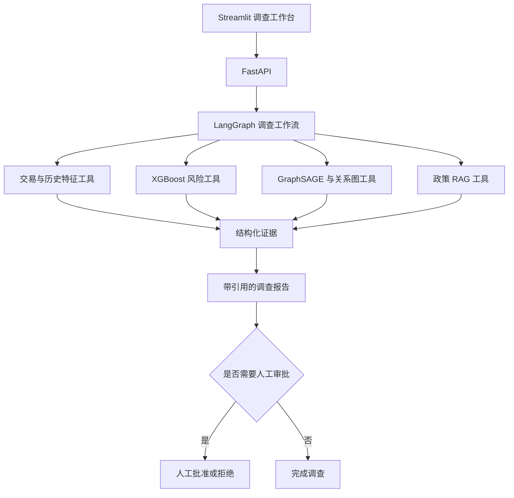

# GraphRisk-Agent 总体项目计划

> 文档状态：已批准，尚未开始执行  
> 当前版本：v1.0  
> 建立日期：2026-09-21  
> 计划周期：Week 0 + 16 周  
> 每周投入：20～24 小时

## 1. 项目使命

GraphRisk-Agent 是一个面向求职展示的智能风控调查系统。项目使用交易欺诈作为业务场景，重点证明开发者能够设计、实现、评估和部署一个可靠的 LLM Agent 应用。

系统以交易为主要调查对象。用户输入 `transaction_id` 后，系统应调用结构化数据、风险模型、关系图和政策知识库，生成带证据与引用的调查报告，并将高风险处置交给人工审批。

本项目服务于以下求职方向：

- LLM 应用算法工程师；
- Agent 算法工程师；
- RAG 算法工程师；
- AI 应用工程师；
- 知识图谱／大模型应用算法工程师。

项目的核心叙事是：

> 构建一个可以可靠调用 XGBoost、GraphSAGE、SQL、图查询和 RAG 工具的风控调查 Agent，并使用系统化评估证明它的有效性和边界。

## 2. 最终用户体验

用户在调查工作台中输入一笔交易编号。系统依次完成：

1. 查询交易与历史特征；
2. 获取 XGBoost 风险分数；
3. 获取 GraphSAGE 图风险分数；
4. 查询相关卡片、设备、邮箱域和地址；
5. 检索适用的风控政策；
6. 整理模型证据、图证据和政策证据；
7. 生成结构化调查报告；
8. 对高风险建议请求人工批准。

## 3. 成功标准

以下条件全部满足，项目才算完成：

1. 新环境可以按照 README 安装并运行核心 Demo；
2. 时间切分和历史特征具有自动化测试，能够证明不存在已知的未来数据泄漏；
3. XGBoost、GraphSAGE 和简单融合在同一时间测试集上完成公平比较；
4. 至少建立 50 个 Agent 评估案例；
5. 评估报告覆盖工具选择、参数生成、证据引用、任务完成、失败恢复、延迟和调用成本；
6. 可以现场完成一次带模型证据、图关系、政策引用和人工审批的交易调查；
7. 代码、配置、测试和文档可以公开，原始受限数据、密钥和本地模型文件不会进入 Git。

## 4. 范围边界

### 4.1 必须完成

- 可复现的 Python 工程和自动测试；
- IEEE-CIS 或替代数据的时间切分与历史特征管线；
- XGBoost 基线；
- GraphSAGE 基线；
- 简单模型融合与统一评估；
- 结构化、无 LLM 依赖的调查工具；
- 带引用的政策 RAG；
- 受控 LangGraph 工作流；
- 超时、重试、失败恢复和人工审批；
- FastAPI、Streamlit Demo 和 Docker 化；
- Agent 评估集与评估报告；
- 英文主 README、中文说明和面试材料。

### 4.2 达标后增强

- PostgreSQL 与 pgvector 正式集成；
- Neo4j 图查询和可视化；
- API 模型与本地量化小模型对比；
- 独立 GraphRAG 企业知识助手；
- MLflow 模型注册与更完整的可观测性。

### 4.3 优先删减

进度落后时，按以下顺序删减：

1. Feast；
2. 异构 GNN；
3. 复杂模型融合；
4. 500～1000 并发压测；
5. 完整本地 LLM 适配；
6. 高级监控面板。

## 5. 数据原则

- 主数据优先使用 IEEE-CIS Fraud Detection；
- 无法及时取得数据时，使用公开小型数据或合成交易数据打通完整管线；
- 训练、验证和测试严格按照 `TransactionDT` 排序切分；
- 所有历史统计只能使用当前交易发生前的信息；
- 图训练数据不得包含验证集和测试集中的未来关系；
- IEEE-CIS 中不存在可直接解释为真实用户的完整实体；
- 可以使用明确记录的规则生成 `identity_key`，但不得声称它是真实用户 ID；
- 合成政策、案例和身份信息必须清晰标注；
- 原始 IEEE-CIS 数据不提交 Git。

## 6. 模型与 Agent 原则

- PR-AUC 为主要离线模型指标，ROC-AUC、Recall、Precision、F1、Recall@Top-K 和 Precision@Top-K 为辅助指标；
- 模型比较必须使用同一时间测试集；
- 项目不预设 GNN 一定优于 XGBoost；
- Agent 的每个工具必须有明确输入、结构化输出和独立测试；
- Agent 使用有限状态工作流，在受控工具集合中做选择；
- 确定性检查负责验证工具、参数、引用和工作流结果；
- LLM-as-a-judge 只作为回答质量的辅助评估；
- Agent 负责调查、解释和建议，不自动执行封禁等高风险操作；
- 高风险建议必须进入人工审批节点。

## 7. 冻结技术栈

| 层次 | 技术 |
|---|---|
| Python | Python 3.11、uv |
| 数据 | Parquet、DuckDB、PostgreSQL |
| 向量检索 | pgvector，通过统一 Retriever 接口封装 |
| 机器学习 | scikit-learn、XGBoost |
| 图学习 | PyTorch、PyTorch Geometric、GraphSAGE |
| 图查询 | 初期本地图结构，后期 Neo4j |
| Agent | LangGraph |
| API | FastAPI、Pydantic |
| 前端 | Streamlit |
| 实验管理 | MLflow，精简使用 |
| 测试 | pytest、Agent evaluation suite |
| 部署 | Docker Compose、GitHub Actions |

技术栈发生变化时，必须先在对应阶段文档中记录原因、替代方案和影响；跨阶段变化同时更新本文档。

## 8. 阶段路线

| 阶段 | 时间 | 主要结果 | 文档 |
|---|---|---|---|
| Stage 00 | Week 0 | 环境、磁盘和数据门禁 | [Stage 00](docs/plans/stage-00-preflight.md) |
| Stage 01 | Week 1～2 | 工程骨架与时间正确的数据管线 | [Stage 01](docs/plans/stage-01-foundation-data.md) |
| Stage 02 | Week 3 | XGBoost、统一评估和预测 API | [Stage 02](docs/plans/stage-02-ml-service.md) |
| Stage 03 | Week 4 | 确定性调查工具与无 LLM 工作流 | [Stage 03](docs/plans/stage-03-investigation-tools.md) |
| Stage 04 | Week 5 | GraphSAGE 与图查询工具 | [Stage 04](docs/plans/stage-04-graph-risk.md) |
| Stage 05 | Week 6～7 | RAG、LangGraph、失败恢复和审批 | [Stage 05](docs/plans/stage-05-rag-agent.md) |
| Stage 06 | Week 8 | 可演示 MVP 与首份 Agent 评估报告 | [Stage 06](docs/plans/stage-06-mvp.md) |
| Stage 07 | Week 9～10 | 扩充评估和正式基础设施 | [Stage 07](docs/plans/stage-07-hardening-platform.md) |
| Stage 08 | Week 11～12 | 本地模型对比与独立 GraphRAG | [Stage 08](docs/plans/stage-08-local-model-graphrag.md) |
| Stage 09 | Week 13～14 | CI、可观测性与可靠性 | [Stage 09](docs/plans/stage-09-quality-operations.md) |
| Stage 10 | Week 15～16 | 性能、演示和求职材料 | [Stage 10](docs/plans/stage-10-delivery-career.md) |

任何阶段未通过验收门禁时，不进入依赖它的后续阶段。

## 9. 每周时间预算

| 工作 | 每周时间 |
|---|---:|
| 实现、测试和调试 | 12～14 小时 |
| 学习当前任务需要的知识 | 4～5 小时 |
| 阅读并解释关键代码 | 2 小时 |
| Agent 评估、失败复盘和文档 | 2 小时 |
| SQL、算法或面试表达 | 1 小时 |

学习内容由本周交付倒推。禁止为了“先学完”而长期推迟可运行交付。

## 10. 文档维护规则

本文档是项目目标和跨阶段边界的唯一事实来源。阶段细节以 `docs/plans/` 中的对应文件为准。

每次范围、架构、数据、指标或进度发生变化时：

1. 先更新当前阶段文件中的“计划变更”和“决策记录”；
2. 如果变化影响其他阶段，再更新本文档；
3. 在代码提交中同时包含相应文档修改；
4. 只有附有测试、报告、截图或可运行命令等证据时，任务才能标记为完成；
5. 阶段结束时填写实际结果、未完成项、遗留风险和下一阶段输入。

详细流程见 [阶段文档索引](docs/plans/README.md)。

## 11. 当前已知条件与风险

- 当前仓库为空，尚未进入 Stage 00；
- 本机存在 Git 和 uv，但尚无可用项目 Python 环境；
- Docker、PostgreSQL 和 Neo4j 尚未安装或不可用；
- GPU 为 RTX 2060 6GB，适合受控规模 GraphSAGE 和量化小模型实验；
- 内存约 16GB，数据处理需要避免复制完整宽表；
- E 盘当前空间不足，执行前需要清理到至少 30～50GB 可用空间；
- IEEE-CIS 数据尚未取得；
- LLM API 总预算控制在 100～200 元，实验必须记录 Token 和估算成本。

## 12. 当前状态

Stage 00 已于 2026-09-21 完成：

- Git 仓库已经初始化；
- 仓库内 Python 3.11.16、uv 锁文件和虚拟环境可用；
- smoke test 为 2/2 通过；
- E 盘约有 47.52GB 可用空间；
- 数据入口、保存路径、许可处理、来源记录和合成后备方案已经文档化；
- Docker、PostgreSQL 和 Neo4j 按计划后置。

IEEE-CIS 的认证下载仍需用户使用自己的 Kaggle 账户接受规则。该事项不阻塞使用合成数据契约进入 Stage 01，但真实数据到位前不得报告真实数据集模型指标。

Stage 01 已于 2026-09-21 完成：

- 建立可安装的 `src` layout Python package；
- 建立配置、结构化日志和 canonical transaction contract；
- 使用 DuckDB 完成数据校验、标准化和 Parquet 输出；
- 实现 1 小时、24 小时和 7 天严格历史窗口特征；
- 完成 70%/15%/15% 时间切分；
- 建立 13 项测试，包括同时间事件隔离和未来交易不改变历史特征；
- 5,000 行合成管线连续运行两次得到相同 SHA-256 产物；
- 详细验证记录位于 `reports/stage-01-validation.md`。

IEEE-CIS 原始数据与 adapter 仍待用户完成 Kaggle 规则接受和数据下载。当前合成数据仅用于验证工程管线，不作为真实模型效果证据。

Stage 02 尚未开始。
