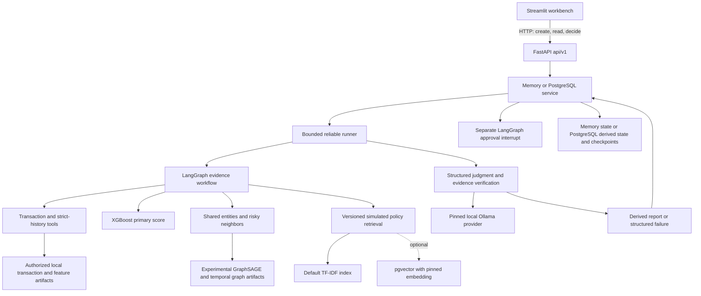
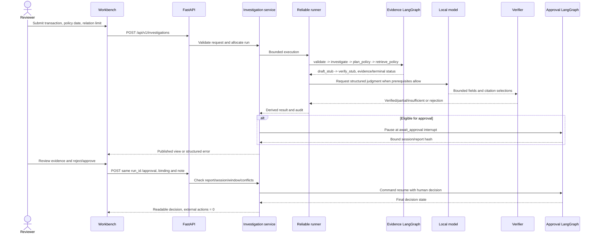

# System architecture and lifecycle

2026-10-18，对应当前有界流程与coverage增强profile。[启动指南](../data/stage-10-startup.md) · [评估](../../reports/stage-10-final-evaluation.md)。

## Components



调用由应用控制。当前policy默认TF-IDF；pgvector需显式索引/迁移/embedding配置。图风险是实验信号，主评分为XGBoost，三折融合无增益。共享实体是线索；原始数据/权重留本地文件，运行数据库只保存允许的派生报告、版本、追踪/费用和审批检查点。

主项目RAG从模拟风控政策取出处；独立Enterprise GraphRAG在另一包中使用原创模拟IT资料、文本与最多两跳图路径，它不是主项目调查链里自动调用的模块。

## Investigation and approval



证据图节点名称是实际实现的validate/investigate/plan_policy/retrieve_policy/draft_stub/verify_stub；draft_stub/verify_stub只做结构准备。真实模型报告阶段在ReliableRunner调用的QualityReportWorkflow内完成，不能把stub写成真实模型已经核验。无证据、无政策、超时、费用/步骤上限和无效输出走相应终态；不保证每笔都有模型调用、报告或审批。

## PostgreSQL restart and idempotency

```mermaid
sequenceDiagram
    participant C as Client
    participant P1 as API instance 1
    participant DB as PostgreSQL and checkpointer
    participant P2 as API instance 2
    Note over C,P2: verified and unexpired normal publication/recovery path
    C->>P1: Create request with idempotency key
    P1->>DB: Reserve key/run and persist derived report
    P1->>DB: Persist bound approval interrupt then publish
    P1-->>C: run_id, report hash and session
    Note over P1,P2: Instance 1 stops; instance 2 uses the same DB
    C->>P2: GET same run_id
    P2->>DB: Read and validate persisted bindings and TTL
    DB-->>P2: Existing report and approval state
    P2-->>C: Same report, no new inference
    C->>P2: Submit decision with original bindings
    P2->>DB: Lock row, register intent, resume checkpoint, finalize
    P2-->>C: Decision result
    C->>P2: Retry identical decision
    P2-->>C: Existing result; conflicting decision returns 409
```

创建幂等与审批幂等是不同合同。发布前中断/费用未知可能返回503，需要核对，不自动再次生成。该图是流程概览，具体事务/检查点恢复由backend执行，不是一次SQL事务包住模型网络请求。对外摘要hash不是防恶意管理员改库的数字签名。

| 行为 | memory | postgres |
|---|---|---|
| 当前coverage启动脚本 | 显式默认 | 需手动环境/迁移入口 |
| API重启后旧报告/审批 | 丢失，旧实例run_id可返回410 | 在TTL/版本/哈希通过时恢复，无新推理 |
| 创建Idempotency-Key | 不支持，422 | 已发布同键同请求200，同键异请求409 |
| partial_evidence | 保留冻结旧兼容行为，可能有待审 | 保存部分报告，不建审批检查点 |
| 数据库故障 | 不适用 | 拒绝服务/就绪503，不回退内存 |
| 外部业务动作 | 0 | 0 |

运行默认TTL24小时、审批30分钟；重启不延长，过期410。reviewer_id仅演示标识，单worker不证明生产并发安全。完整限制见[限制清单](../data/stage-10-known-limitations.md)。

## Source map

| 组件 | 当前源码/符号 |
|---|---|
| UI与HTTP客户端 | [streamlit_app.py](../../streamlit_app.py)、[Stage06ApiClient](../../src/graphrisk/demo/api_client.py) |
| API组合/路由 | [create_app](../../api/main.py)、[investigation router](../../api/investigation.py) |
| 服务/公开投影 | [Stage06Service](../../src/graphrisk/serving/investigation_service.py)、[views](../../src/graphrisk/serving/investigation_views.py) |
| 有界执行与图 | [Stage05ReliableRunner](../../src/graphrisk/agent/reliability.py)、[Stage05GraphWorkflow](../../src/graphrisk/agent/workflow.py) |
| 当前结构化报告 | [QualityReportWorkflow](../../src/graphrisk/agent/quality_reporting.py)、[quality evidence](../../src/graphrisk/agent/quality_evidence.py) |
| 审批暂停/继续 | [Stage05ApprovalWorkflow](../../src/graphrisk/agent/approval.py) |
| 持久化/恢复 | [PostgresInvestigationService](../../src/graphrisk/serving/postgres_service.py)、[PostgresStore](../../src/graphrisk/serving/postgres_store.py) |
| 关系/主模型决定 | [coverage service](../../src/graphrisk/graph/coverage_service.py)、[模型卡](../data/stage-09-5b-model-card.md) |

本路线核对图与源码，不以架构图替代新的真实调查、数据库恢复或生产验收。
