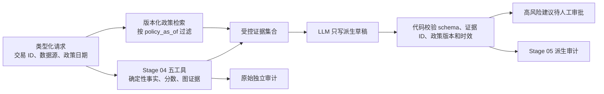

# Stage 05 路线 0：实验与信任边界契约

> 2026-09-24 冻结的设计边界。此文档定义后续路线的输入、派生输出和审计责任；LangGraph 与本地生成端已通过路线 0 smoke，但政策检索、正式 Agent 和报告生成仍未实现。

## 输入与来源

`Stage05Request` 要求 `transaction_id`、`dataset_source`、`policy_as_of`，可选 `relation_limit`。`policy_as_of` 必须是显式的 `YYYY-MM-DD` 日期，不能从 IEEE-CIS 的人工锚定 `TransactionDT` 推导。`dataset_source` 必须与 Stage 01 数据、Stage 02 训练和 Stage 04 图配置一致。配置中的 `graph_comparison_run` 指向同源的冻结比较产物；Stage 04 的五工具报告和审计由原工作流生成，不由 LLM 修改。`identity_key` 仍是启发式关联，不是核验过的客户 ID。

## 数据流与边界

请求、IEEE-CIS 行、政策文本、模型输出和审批输入是不同信任级别。政策片段及模型草稿均作为数据处理，不能更改工具白名单、预算或审批规则。高风险建议在 Stage 05 只改变建议状态，不触发外部账户或支付操作。

## 后续报告边界

Stage 05 生成**派生报告**，保留 Stage 04 原报告与 `investigation_id` 引用。路线 5 具体实现 schema 时至少包含：`schema_version`、请求 ID/数据源/`policy_as_of`、原报告状态、逐条事实/模型/图证据 ID、政策结论及 `doc_id/version/section/chunk_id`、不确定性、建议动作、校验状态和审批状态。不得把未校准风险分数写成已证实的欺诈概率；`partial`、无政策命中、旧版政策和模型失败必须在输出中可辨，不能变成 `completed` 的肯定政策结论。生成的自然语言不能覆盖原始工具结果。

Stage 05 派生审计与报告分离：记录 `investigation_id`、节点/工具、状态/错误码、模型和 prompt 版本、检索索引版本、耗时、Token、估算费用、预算余量、审批事件及报告哈希。不得保存 API key、完整原始宽表、训练标签、私有模型文件或无必要的实体明文。Token/费用未知时必须明确标为未知，不填零。路线 7 实现真实计数及费用停止逻辑；路线 0 先冻结配置上限，不声称费用控制已运行。

## 资源与预算

配置在 [stage05.yaml](../../configs/stage05.yaml) 中：每次调查最多 12 步、2 次模型调用、2 次政策查询、1 次重试、总时长 300 秒；单次生成输出不超过 512 Token、请求超时 180 秒。Stage 05 API 预算上限 30 元，24 元为停止阈值，处于项目总预算 100～200 元之内。`generation.provider: local_http` 绑定 loopback Ollama、模型名称及实际 digest；路线 0 的真实 JSON smoke 已通过，性能与版本见[门禁记录](../../reports/stage-05-route-0-preflight.md)。这只证明本地生成端可调用，不证明它能够生成有依据的政策结论。词法检索基线暂用已有 scikit-learn；它不代表本地 embedding 已通过验证。

## 继续门禁

路线 0 的锁定依赖、fake 图和真实生成端 smoke 已有证据，可进入路线 1。路线 2 的 dense 检索仍需单独做 embedding 资源门禁；路线 4～8 还须逐项验证正式工具编排、报告引用和审批安全，Stage 05 整体保持 `In Progress`。
