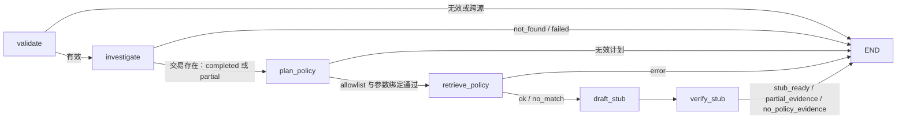

# Stage 05 路线 4：有界 LangGraph 工作流契约

> 本文件记录路线 4 编排骨架。`draft_stub` 使用确定性 fake provider，`verify_stub` 只校验引用 ID 结构；路线 5 已另行交付[派生报告与引用核验](stage-05-reporting.md)，人工审批仍属于路线 6。

## 请求和状态

入口使用 `Stage05Request`：`transaction_id`、固定 `dataset_source`、显式 `policy_as_of` 和 `relation_limit`。图首先验证输入及数据源绑定，不把 IEEE-CIS 的人工交易时间当政策适用日期。内部状态只保存已验证请求、Stage 04 调查报告和独立审计、类型化政策计划、检索结果、占位草稿、结构检查、错误、步数和调用计数；Pydantic 输出 `Stage05GraphRun` 可序列化。原始请求不进入最终结果，审批状态固定为 `not_requested`。

| 节点 | 输入 | 输出和权限 |
|---|---|---|
| `validate` | 原始请求 | 严格校验及同源绑定；失败直接终止 |
| `investigate` | 已验证交易 ID/数据源/关系上限 | **只调用原有** `InvestigationWorkflow.run`，保留五工具报告与审计；交易不存在、输入失败或依赖失败时终止 |
| `plan_policy` | 请求和 Stage 04 报告 | 确定性计划，且必须通过 `PolicyQueryPlan` 的 `retrieve_policy` allowlist、交易 ID、数据源、日期和 `top_k` 绑定；无任意 SQL 或图工具调用 |
| `retrieve_policy` | 类型化计划 | 仅调用统一 `PolicyRetriever` 一次；错误终止，`no_match` 仍进入明确的无证据分支 |
| `draft_stub` | 调查与检索结果 | fake provider 仅列出本次检索 `chunk_id`，无政策结论、无外部动作 |
| `verify_stub` | 占位草稿 | 拒绝伪造/重复引用和有命中却不引用；标记 `semantic_validation_pending=true`，按证据状态结束 |



每个节点进入前检查 `max_steps`，检索和 fake provider 另受 `max_policy_queries`、`max_model_calls` 上限约束；全图没有回边，并给 LangGraph 设置递归上限。达到上限时返回 `step_limit`，不会调用后续依赖。所有异常输出使用固定错误码和安全文案，不回显文件路径、堆栈或原始数据。

## 三条必须能讲清的路径

1. **正常 fixture。** Stage 04 `completed`，政策 `ok` → 6 节点、1 次检索、1 次 fake 草稿，终态 `stub_ready`；`structure_only` **不代表**政策结论已通过语义验证。
2. **图目标未覆盖。** Stage 04 `partial`、图能力缺口保留，但交易/模型/关系证据仍可检索政策 → 终态 `partial_evidence`。无论政策是否命中，不能升级成 `completed`。
3. **无政策命中。** Stage 04 可完成，检索 `no_match` → 草稿引用空列表、验证为 `no_policy_evidence`、终态同名。后续路线 5 必须写“无法依据现有政策判断”。

交易不存在时只执行 `validate` 和 `investigate`，不调用检索或 fake provider。错误计划（未知工具、错交易/数据源/日期、超出 `top_k`）停在 `invalid_plan`；检索失败停在 `retrieval_error`。路线 7 才补充超时、有限重试和费用执行门禁；本路线不把这些能力标为已完成。

## 复现

```powershell
uv run --offline pytest tests/unit/test_stage05_graph_workflow.py -q
uv run --offline python scripts/run_stage05_graph.py 3488959 --policy-as-of 2026-07-01 --relation-limit 3 --config configs/stage05.yaml --output reports/generated/stage05/route4-3488959.json
```

命令复用当前本地 IEEE-CIS/Stage 04 产物，并把结果写入 Git 忽略目录。若图产物不可用，调查报告会真实返回 `partial`，本图保持 `partial_evidence`；这正是部分失败路径，不应伪装为成功的图证据。测试使用固定 Stage 04 报告 fixture 和本地政策索引，不依赖网络、Ollama 或 API 费用。
