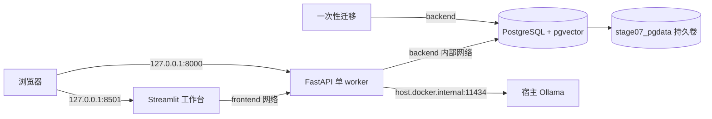

# Stage 07 Compose 操作与数据边界

> 路线 7 已通过真容器门禁，路线 8 已完成 Stage 07 工程总验收。[真容器记录](../../reports/stage-07-route-7-compose-faults.md) · [逐项总验收](../../reports/stage-07-route-8-acceptance.md) · [中文演示](stage-07-demo-guide.md)。

## 拓扑与前置



`compose.stage07.yaml` 独立于 Stage 06 的 `compose.yaml`。DB 仅在 `backend` 内部网络，没有默认宿主端口；API 同时加入前端/后端网络，只有 API 挂载只读 IEEE-CIS 特征、模型/图/政策工件及可写生成报告目录。工作台只连接 API，无数据或 secret 挂载。宿主 Ollama 的生成和 embedding 端点均固定为 `host.docker.internal:11434`，两个模型 digest 在 `configs/stage07_compose.yaml` 固定；Stage 06 TF-IDF 默认不变。DB 卷用于保存运行、LangGraph 检查点、审批、费用和 pgvector 行；它不等于备份。

需要 Python 3.11、锁定的本地项目环境、Stage 06 镜像 `graphrisk-stage06:local`、pgvector 镜像 `pgvector/pgvector:0.8.6-pg17-bookworm`、本机 Ollama 两个固定模型、IEEE-CIS 特征/模型/图工件和已构建的 `policy-index-local_embedding.json`。若 Stage 06 镜像不存在，先执行 `docker compose -f compose.yaml build api`。`Dockerfile.stage07` 在该镜像上仅同步新增的 PostgreSQL/checkpoint 锁定依赖；不会修改旧镜像。先按[政策索引合同](stage-07-pgvector-retrieval.md)在宿主构建 dense 索引，Compose 的一次性 `bootstrap` 将迁移数据库、导入 16 段并授予受限应用角色。API 不自动迁移，也不在 DB 不可用时回退内存。

## 创建本地 secret 并启动

首次使用时在仓库根目录创建忽略的 secret 文件。不要覆盖已与现有数据库卷绑定的管理员密码；后续轮换须在库内同步变更。命令只输出状态，不输出密码：

```powershell
New-Item -ItemType Directory -Force .secrets/stage07 | Out-Null
uv run --offline python -c "from pathlib import Path; import secrets; p=Path('.secrets/stage07'); [(p/n).write_text(secrets.token_urlsafe(36), encoding='utf-8') for n in ('admin_password','app_password') if not (p/n).exists()]; print('Stage 07 secrets ready')"
docker compose -f compose.stage07.yaml config --quiet
docker compose -f compose.stage07.yaml up -d --build
Invoke-RestMethod http://127.0.0.1:8000/api/v1/ready
Invoke-WebRequest http://127.0.0.1:8501/_stcore/health
```

管理员 secret 仅供 DB 和一次性迁移容器；API 仅挂载应用 secret；工作台没有 secret。启动入口从 secret 文件临时构造 DSN，不把密码写在 Compose YAML、镜像环境、Git 或日志。数据库角色不能创建 schema、不是 superuser，对向量表只有 SELECT。`/api/v1/ready` 必须返回 `postgres: true` 等全部组件 true 才算就绪；`/api/v1/health` 只证明进程存活。首次启动可能需要等待模型和图工件装载，不能把 Compose 配置语法通过当作运行验收。

需要本机直连 DB 调试时，单独加 `-f compose.stage07-debug.yaml`；它仅把 DB 发布在 `127.0.0.1:15433`。默认文件没有 DB 端口。调试完使用相同的 `-f` 组合关闭，避免误以为端口不再开放。

## 重启和故障练习

固定演示请求为 `transaction_id=3488959`、`dataset_source=ieee_cis`、`policy_as_of=2026-07-01`、`relation_limit=3`。记录返回的 `run_id`、`session_id`、`report_sha256` 和 `X-Request-ID`，不要存原始交易行。审批前运行：

```powershell
docker compose -f compose.stage07.yaml up -d --no-deps --force-recreate api
# GET /api/v1/investigations/{run_id} 应仍是同一哈希、pending。
# 提交绑定同一 run/session/transaction/hash 的 reject，再重复 reject、尝试 approve。
docker compose -f compose.stage07.yaml stop db
# /api/v1/ready 与已存运行 GET/新调查 POST 应安全返回 503。
docker compose -f compose.stage07.yaml start db
# 待 db healthy 后，GET 同一 run_id 并确认报告哈希与拒绝状态。
docker compose -f compose.stage07.yaml down
docker compose -f compose.stage07.yaml up -d --no-build
# 再次确认相同运行记录、政策 16 段、工作台健康。
```

普通 `docker compose down` 删除容器和网络，但保留 `stage07_pgdata` 卷；再次启动会重复执行安全迁移和固定索引核验。**不要用 `down -v` 模拟重启**：那会删除数据库卷，运行记录和审批数据会丢失。演练完可用 `docker compose -f compose.stage07.yaml down` 释放内存，卷和忽略的 secret 文件继续保留。数据库失败时，API 应返回 `persistence_unavailable`，不得降级为内存新运行。

## 数据检查

镜像仅复制应用源码、配置和原创模拟政策；`.dockerignore` 排除 `.secrets/`、原始/派生 IEEE-CIS、模型权重和生成报告。数据/模型/政策以只读 bind mount 提供给 API，报告目录可写，DB 使用独立持久卷。UI 无数据挂载。检查 `docker inspect` 的挂载权限、`docker image inspect` 环境变量、构建上下文清单、Git 跟踪文件，以及 API/UI 投影字段；不得把日志、报告或演示截图中的原始行、标签、身份键、向量和密码当作公开材料。`reviewer_id` 仍未认证，外部动作始终为 0，本拓扑是本地作品演示而非生产部署。

## 2026-10-02 调试端口补充

默认 Compose 保持数据库只接入内部 `backend` 且没有宿主端口。调试覆盖文件现额外为数据库加入单独的非内部 `db_debug` 网络，仍只绑定 `127.0.0.1:15433`。此前只在内部网络上声明端口时，Compose 配置和 `HostConfig.PortBindings` 均有端口，实际 `NetworkSettings.Ports` 却为空，宿主 TCP 不通。需要本机直连时，以含调试覆盖文件的同一 Compose 项目重建 db 容器（保留数据卷），再确认实际端口映射和 TCP 可达；不要仅把 `docker compose config` 通过当作连通。
