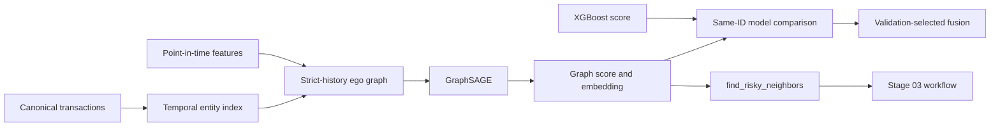

# Stage 04 实现路线：时序 GraphSAGE 与图风险工具

> 编写日期：2026-09-23
> 计划投入：Week 5，约 23 小时
> 当前状态：路线 0～3 已完成；路线 4～7 未开始
> 配套学习路线：[stage-04-learning-roadmap.md](stage-04-learning-roadmap.md)
> 阶段总纲：[stage-04-graph-risk.md](stage-04-graph-risk.md)

## 1. 阶段结果

Stage 04 要把 Stage 03 中明确返回 `unavailable` 的 `find_risky_neighbors` 替换成真实、可追溯的图能力。输入一笔交易后，系统能够：

1. 按该交易发生时间构造只包含严格历史关系的局部图；
2. 使用 GraphSAGE 输出未校准的图风险分数和交易 embedding；
3. 在同一批验证/测试交易上与 Stage 02 XGBoost 公平比较；
4. 使用验证集选择一个简单融合权重，并只在测试集做最终报告；
5. 返回由历史共享实体连接、且具有合格图模型分数的风险邻居；
6. 将图证据接入既有确定性调查工作流、证据绑定和审计记录。

本阶段的成功不要求 GraphSAGE 指标超过 XGBoost。成功标准是图构建时间正确、比较公平、产物可复现、工具证据真实、失败能够安全降级。



## 2. 冻结的工程决策

| 主题 | Stage 04 决定 | 原因 |
|---|---|---|
| 图结构 | 直接保留 Transaction、Card、Device、EmailDomain、Address 节点，不先投影成交易 clique | 避免高频实体导致边数平方增长，并保留可解释路径 |
| 基线模型 | 一个两层 GraphSAGE 交易节点分类基线 | 控制一周范围，求职主线仍是 Agent 应用 |
| 时间语义 | 每个目标交易只使用 `event_time < target_time` 的关系；相同时间视为同时发生并排除 | 与 Stage 01/03 的 point-in-time 规则一致 |
| 训练样本 | 为每个目标构建严格历史 ego graph，再组成 mini-batch | 整个训练期静态图会让早期交易看到后来的结构 |
| 邻居采样 | 按时间、交易 ID 稳定排序后取最近 K 个历史邻居；K 由配置控制 | 可复现、可控内存，并保留近期关系 |
| 节点特征 | 交易节点使用允许清单中的数值历史特征和 `product_code`；card/device/email/address ID 只用于拓扑，不直接 one-hot 输入 | 防止高基数实体记忆，同时让图结构承担关系信息 |
| 标签 | `is_fraud` 只用于训练 loss 和离线评估，不进入节点特征、边、工具输出或报告 | 防止标签泄漏和调查期不可用信息泄漏 |
| 模型选择 | 以验证集 PR-AUC 选 epoch、超参数和融合权重；测试集只运行最终冻结版本 | 避免测试集反向参与选择 |
| 公平比较 | XGBoost、GraphSAGE 和融合必须在完全相同的交易 ID 上计算指标 | 防止通过不同样本掩盖模型差异 |
| 图查询 | 首版使用本地图索引和产物，不引入 Neo4j | 当前环境未安装 Neo4j，统一工具接口允许后续替换 |
| 分数语义 | 图分数与融合分数均标记为未校准风险分数 | 当前阶段不做概率校准和业务阈值验证 |
| 风险邻居 | 只返回严格历史邻居和模型分数，不返回或暗示真实欺诈标签 | 模型风险证据不等于已确认欺诈 |

若实施证据迫使上述决定改变，先在 [stage-04-graph-risk.md](stage-04-graph-risk.md) 的决策记录和计划变更中说明，再修改代码。

## 3. 范围与非目标

### 必须完成

- PyTorch/PyG 可锁定、可导入，并有 CPU 回退；
- 小型确定性图 fixture 和时间泄漏测试；
- 可复现的时序实体索引与 ego graph 构造器；
- GraphSAGE 训练、验证选择、测试评估和版本化产物；
- 同一交易集合上的 XGBoost、GraphSAGE、简单融合比较；
- 图分数、embedding 和图产物 manifest；
- `find_risky_neighbors` 真实实现及调查工作流接入；
- 真实 IEEE-CIS 受控实验、自动化测试和阶段报告。

### 本阶段不做

- Neo4j、异构 GNN、GAT、动态图网络或图数据库可视化；
- 用测试集调超参数、选择融合权重或挑选展示样本；
- 概率校准、自动封禁和人工审批界面；
- 把 embedding 当作自然语言解释；
- 为追求指标使用未来边、同时间边、标签特征或随机重切分；
- 强制全量图进入 GPU。CPU 索引加 mini-batch 是默认方案。

## 4. 时间预算与路线依赖

学习时间已经包含在总时间中，具体任务见配套学习路线。

| 路线 | 主要交付 | 总时间 | 其中学习 | 依赖 |
|---|---|---:|---:|---|
| 0：前置门禁与实验契约 | 环境、配置、比较集合和错误语义 | 2 小时 | 0.5 小时 | Stage 03 |
| 1：图 schema 与时间语义 | 图契约、小 fixture、防泄漏定义 | 3 小时 | 0.75 小时 | 路线 0 |
| 2：图产物构建 | 时序索引、ego graph、manifest | 3.5 小时 | 0.5 小时 | 路线 1 |
| 3：GraphSAGE 训练 | 模型、mini-batch、checkpoint | 5 小时 | 1 小时 | 路线 2 |
| 4：公平评估与融合 | 同 ID 指标、融合和报告 | 3 小时 | 0.5 小时 | 路线 3 |
| 5：图风险工具 | 模型加载、风险邻居、契约测试 | 3 小时 | 0.5 小时 | 路线 4 |
| 6：工作流接入 | 报告、审计、降级和回归 | 2 小时 | 0.25 小时 | 路线 5 |
| 7：端到端验收 | 真实演示、全量回归、复盘 | 1.5 小时 | 0.5 小时 | 路线 6 |
| **合计** |  | **23 小时** | **4.5 小时** |  |

路线必须按顺序通过门禁。尤其不能在路线 1 的时间 fixture 未通过前训练真实数据模型。

## 5. 路线 0：前置门禁与实验契约（约 2 小时）

### 实现目标

在写图模型前确认依赖、设备、数据、产物和比较口径。新增 Stage 04 配置草案，明确数据源、随机种子、图 fanout、batch size、hidden size、epoch 上限、early stopping、CPU/GPU 选择、训练/验证/测试预测输出和产物目录。

**路线 0 已完成。** 配置与同源校验、依赖锁、CPU/CUDA smoke、聚焦测试、全量回归和构建验证均通过。证据汇总于 [路线 0 记录](../../reports/stage-04-route-0-preflight.md)。

检查 `torch` 与 `torch-geometric` 的 Python 3.11/Windows 兼容组合，将版本写入 `pyproject.toml` 与 `uv.lock`。只安装完成本阶段所需的最小依赖，不顺带引入 DGL、Lightning 或图数据库客户端。执行 CPU 张量、设备选择和最小 PyG `SAGEConv` smoke test；CUDA 不可用时自动使用 CPU，并记录实际设备。

同时冻结以下实验契约：

- 默认数据源为 IEEE-CIS，合成数据只用于确定性测试；
- 图实验的训练预算和评估交易集合由配置明确，不在运行中随机改变；
- 三种模型比较使用同一交易 ID 列表和相同标签；
- 若为了一周预算只评估固定子集，必须保存 ID 集合哈希，并在报告中称为“受控图实验”，不得与 Stage 02 全量指标混写；
- 明确“交易存在但没有图预测”“图模型产物缺失”“图产物与数据源不匹配”各自的结构化错误行为；
- 评审 Stage 03 `RiskyNeighbor` 契约是否需要增加时间差、模型版本或分数适用范围；任何 schema 变化先写测试。

### 交付物

- Stage 04 配置文件与配置校验测试；
- PyTorch/PyG 依赖锁和设备 smoke test；
- 实验集合、产物路径、错误分类和 schema 决策记录。

### 完成门禁

- 新环境可通过锁文件安装，`uv run --offline` 能导入 torch/PyG；
- CPU smoke test 必须通过，GPU 只作为加速项；
- 配置拒绝负 fanout、空模型版本、无效设备和交叉数据源；
- 尚未训练时不得把 Stage 04 状态标成完成或让工具返回伪造成功。

## 6. 路线 1：图 schema、特征和时间语义（约 3 小时）

### 实现目标

**路线 1 已完成。** 五类节点、严格历史局部图、训练 ID 拟合的特征编码、小型 PyG 导出和十笔交易 fixture 已实现。逐边预期、泄漏测试与学习解释见 [路线 1 验证记录](../../reports/stage-04-route-1-schema-time.md)和[图 schema 文档](../data/stage-04-graph-schema.md)。路线 2 仍需把参考构建器扩展为大规模时序索引。

建立图数据契约和一个可以手算的 8～12 笔交易 fixture。节点类型为 Transaction、Card、Device、EmailDomain、Address；边表示交易使用某实体。`unknown-*` 等交易唯一占位实体不形成共享关系。

每个目标交易的 ego graph 使用以下规则：

1. 根节点为目标交易；
2. 根节点连接它本次使用的有效实体；
3. 实体只连接发生时间严格早于目标的交易；
4. 相同时间交易不进入历史；
5. 历史交易可继续连接其有效实体，但所有扩展仍受目标时间截止约束；
6. 每类邻居超过上限时，按 `event_time DESC, transaction_id ASC` 稳定截断；
7. 目标和历史交易的 `is_fraud` 都不能进入输入特征。

交易节点的首版特征允许清单为 Stage 02 数值特征、缺失指示和 `product_code` 编码。card、device、email、address 的原始 ID 只映射为图节点，不作为可学习 one-hot 特征。预处理器只在训练交易上拟合；验证和测试只能 transform。

### 必测场景

- 增加一笔未来交易，不改变较早目标的节点、边和特征；
- 同时间共享实体的交易不互为历史邻居；
- `unknown-*` 不连接无关交易；
- 重复实体命中不会重复创建同一条逻辑边；
- 打乱输入行顺序后，节点映射和图内容哈希不变；
- fixture 中加入或修改标签，不改变图结构和节点特征；
- 验证/测试交易和它们的未来关系不进入训练目标的 ego graph。

### 交付物

- 图 schema 文档和字段允许/禁止清单；
- 小型 fixture、期望节点/边清单和时间泄漏测试；
- 节点与边的稳定排序、ID 映射和采样规则。

### 完成门禁

必须能够逐边解释 fixture 中某个目标为何拥有或没有一条边。任何依赖完整静态训练图、导致早期训练交易看见后来结构的方案都不能进入路线 2。

## 7. 路线 2：可复现图产物与 ego graph 构建（约 3.5 小时）

### 实现目标

**路线 2 已完成。** DuckDB 列投影、输入一致性校验、时序实体倒排索引、50k/10k/10k 目标构建、持久化产物、训练 ID 专用 encoder 和可核验 manifest 已实现。参考 fixture 与索引输出一致，两次真实数据构建得到相同 manifest；详细见[图产物契约](../data/stage-04-graph-artifacts.md)和[路线 2 验证记录](../../reports/stage-04-route-2-artifacts.md)。

实现只读图构建管线：从 canonical transaction 和 point-in-time features 读取必要列，按时间和交易 ID 建立实体倒排索引，为目标交易生成有界的严格历史 ego graph，并输出可供训练和查询复用的产物。

建议产物边界：

- 节点映射和节点类型表；
- 带事件时间的交易—实体边表；
- 图模型输入特征及训练期拟合的预处理 metadata；
- train/validation/test 目标交易 ID 清单；
- 图 manifest，记录数据源、时间边界、输入路径与哈希、节点/边数量、占位实体策略、fanout、随机种子、特征列和软件版本；
- 小 fixture 可序列化的 PyG `Data`/`Batch` 样例。

大表处理优先使用 DuckDB 列投影和分批读取。原始 CSV、Parquet、映射表和图二进制产物继续保存在 Git 忽略目录。运行日志只记录计数、版本和耗时，不输出完整实体值。

### 验证

- 同一输入和配置运行两次，manifest 中的内容哈希一致；
- 每个 ego graph 的最大历史事件时间严格小于根交易时间；
- 实际节点数、边数、孤立/新实体比例和截断比例被统计；
- 非法、缺失或交叉来源的输入以可行动错误失败；
- 50k 里程碑先通过，再决定是否进入 100k 或更大规模。

### 完成门禁

小 fixture 和第一档真实数据均可重复构建；没有未来/同时间边；内存峰值与运行时间有记录。若 100k 超出预算，可以保留 50k 受控实验，但必须保留同一比较集合和明确规模标签。

## 8. 路线 3：GraphSAGE 训练与版本化（约 5 小时）

### 实现目标

**路线 3 已完成。** 两层 GraphSAGE、逐批严格历史图、训练集正例权重、验证 PR-AUC 选模与早停、冻结后单次测试、版本化 checkpoint 和 CPU 重新加载均已验收。真实 IEEE-CIS 50k/10k/10k 训练的最佳 epoch 为 2，验证/测试 PR-AUC 为 0.178343/0.103733。后续新增独立运行名与仅验证集调参入口，见[自助指南](../guides/graphsage-self-training.md)。训练契约与正式结果见[训练契约](../data/stage-04-graphsage-training.md)和[路线 3 验证记录](../../reports/stage-04-route-3-training.md)。路线 4 仍需完成同 ID 受控比较。

实现两层 GraphSAGE 交易节点分类器。每个样本是路线 2 生成的严格历史 ego graph，多个样本使用 PyG mini-batch 合并，根交易节点的 embedding 进入分类头。首版只保留少量可解释超参数：hidden size、dropout、fanout、batch size、learning rate 和 epoch 上限。

训练要求：

- 固定 Python、NumPy 和 PyTorch 随机种子；
- 数值预处理只在训练数据拟合；
- 类别不平衡权重只由训练标签计算；
- 使用 `BCEWithLogitsLoss`，模型输出经 sigmoid 得到未校准分数；
- 每个 epoch 以验证 PR-AUC 选择 checkpoint，并记录 ROC-AUC 等辅助指标；
- early stopping 只查看验证集；
- 测试集在模型和超参数冻结后运行一次；
- CPU 模式必须可运行，CUDA 模式记录设备、显存和回退原因；
- 保存模型权重、模型配置、预处理器、训练历史、manifest 引用和内容哈希。

先让模型在小 fixture 上过拟合以验证反向传播和根节点选择，再运行合成/小规模 IEEE-CIS，最后进入受控正式实验。小 fixture 过拟合只用于调试，不作为业务指标。

### 必测场景

- forward 输出形状、范围和 root-node 对齐正确；
- 单步训练确实更新参数；
- 相同种子和输入得到可接受的重复结果；
- 模型拒绝特征维度、数据源或 manifest 不匹配的产物；
- CPU 加载 GPU checkpoint 时使用明确 `map_location`；
- checkpoint 缺失或损坏产生结构化失败。

### 完成门禁

训练在当前 6GB GPU 或 CPU 降级模式下完成，产生可重新加载的 champion。报告必须写明训练规模、正例比例、训练时长、最佳 epoch 和实际设备。

## 9. 路线 4：同集合评估、embedding 与简单融合（约 3 小时）

**路线 4 已完成。** 受控 XGBoost 使用 GraphSAGE 的 50,000 个训练目标，验证/测试各在相同 10,000 个目标上对比；验证集选出的 alpha 为 0.5。测试 PR-AUC：XGBoost 0.129566、GraphSAGE 0.103733、融合 0.128175；融合没有超过 XGBoost。逐交易分数、64 维 embedding、ID 哈希、冷启动/截断与延迟诊断见[比较契约](../data/stage-04-model-comparison.md)和[验收记录](../../reports/stage-04-route-4-comparison.md)。

### 实现目标

为验证和测试目标输出 `transaction_id`、split、GraphSAGE score、模型版本和 embedding 引用。模型比较先对交易 ID 做 inner join 并断言一一对应，任何缺失或重复都直接失败。

报告以下指标：

- 主要指标：PR-AUC；
- 辅助指标：ROC-AUC、Precision、Recall、F1、Recall@Top-K、Precision@Top-K；
- 工程指标：构图耗时、训练耗时、单样本/批量推理延迟、产物大小；
- 数据诊断：评估交易数、正例数、冷启动实体比例、被 fanout 截断比例。

受控实验的主对比应让 XGBoost 在与 GraphSAGE 相同的训练交易 ID 上重新训练，并在相同验证/测试 ID 上评估；Stage 02 使用全量训练集的既有 champion 可作为额外参考行，但不得与受控实验主对比混写为同等训练预算。训练 ID 和评估 ID 的顺序、数量与 SHA-256 必须入报告。

简单融合采用固定候选权重的加权平均：

```text
fusion_score = alpha * xgboost_score + (1 - alpha) * graph_score
```

`alpha` 只根据验证集 PR-AUC 选择，随后冻结并在测试集评估。两个分数都未校准，因此融合也不能解释成欺诈概率。若 GraphSAGE 或融合更差，保留结果并分析冷启动、弱关系或规模限制，不更换测试集。

embedding 只作为版本化机器表示输出，可用于后续检索或可视化；本阶段不把 embedding 维度解释成人类可读原因。

### 交付物

- 同 ID 的验证/测试预测表；
- XGBoost、GraphSAGE、融合指标对比表；
- 验证集权重选择记录；
- 训练与评估报告、最小化 embedding 样例。

### 完成门禁

三组指标来自完全相同的测试交易 ID；测试标签未用于模型、阈值或融合选择；受控实验与 Stage 02 全量指标分开标注。

## 10. 路线 5：图模型服务与 `find_risky_neighbors`（约 3 小时）

**路线 5 已完成。** `GraphRiskService` 启动时一次加载并校验图、checkpoint 和 held-out 分数；`find_risky_neighbors` 从严格历史 ego graph 返回具名共享实体、GraphSAGE 分数、时间差和模型证据。训练 in-sample 分数被排除；真实 IEEE-CIS 固定目标已有成功、空结果和未覆盖状态验收。见[服务契约](../data/stage-04-graph-service.md)与[验收记录](../../reports/stage-04-route-5-graph-service.md)。完整调查工作流注入属于路线 6。

### 实现目标

实现图产物加载器、图风险预测入口和 Stage 03 预留的 `find_risky_neighbors`。加载器验证数据源、模型版本、特征 schema、图 manifest 和必要文件，不在每次工具调用中重复加载模型。

风险邻居工具执行：

1. 校验请求、数据源和目标交易；
2. 找到严格早于目标、通过共享有效实体连接的候选交易；
3. 只使用符合既定适用范围的图模型分数，不读取 `is_fraud`；
4. 按 `graph_risk_score DESC`、`seconds_before_target ASC`、`transaction_id ASC` 稳定排序；
5. 返回有限数量的交易、图风险分数、共享实体、模型版本和证据绑定；
6. 没有合格邻居时返回空列表和 `ok`；目标未覆盖、产物缺失或版本错配时返回对应结构化状态。

路线 0 必须明确训练交易的 in-sample 分数能否成为邻居证据。默认更保守的实现是：工具只返回 manifest 标记为 held-out 或正式推理产生的分数；in-sample 训练分数不得伪装成独立风险证据。

### 必测场景

- 高风险分数排序与 limit；
- 未来、同时间、`unknown-*` 和无分数候选排除；
- 多实体命中去重但保留完整共享路径；
- 空结果、目标未覆盖、模型缺失、manifest 错配和损坏产物；
- 输出不含标签、原始宽表或未经约束的异常文本；
- 同一输入和模型版本返回相同业务内容。

### 完成门禁

Stage 03 的图占位测试被真实成功与失败测试替换；工具返回的每个邻居都能追溯到严格历史边和特定模型版本。

## 11. 路线 6：确定性工作流接入与回归（约 2 小时）

### 实现目标

让既有调查工作流使用真实 `find_risky_neighbors`，在报告中增加图模型版本、图风险邻居、共享实体路径、分数限制和融合结果（若目标同时具有两种分数）。保持 Stage 03 的固定调用顺序、确定性报告、独立审计和部分失败语义。

工作流必须做到：

- 图模型成功时写入图证据和 evidence binding；
- 图模型不可用时保留交易、历史特征、XGBoost 和直接关系证据，报告状态为明确的 partial/能力缺口；
- 图分数与直接共享关系分开呈现；
- 不写“模型确认欺诈”“邻居是欺诈用户”等越界结论；
- 审计只记录工具元数据、状态、版本和耗时，不记录标签或完整实体表。

### 验证

- 更新固定报告 fixture；
- 成功、空邻居、目标未覆盖、模型损坏和来源错配的工作流测试；
- 同一输入连续运行的报告内容哈希一致，审计 ID/时间不同；
- Stage 00～03 全量回归测试继续通过。

### 完成门禁

图工具的接入不改变既有交易、特征、XGBoost 和关系证据语义；图依赖失败不会导致整个调查崩溃或伪造结论。

## 12. 路线 7：端到端验收与复盘（约 1.5 小时）

### 实现目标

运行聚焦测试、全量测试、构建检查和至少一次真实 IEEE-CIS 调查。选择展示交易时使用预先声明的评估集合和固定规则，不能根据测试标签挑选“好看案例”。连续运行两次并比较报告内容哈希。

阶段报告至少记录：

- 依赖与实际设备；
- 图规模、时间范围、正例比例、fanout 和截断率；
- 防泄漏测试证据；
- 最佳 epoch、训练时间、推理延迟和产物大小；
- 同 ID 的三模型验证/测试对比；
- 一笔成功调查和至少两个失败恢复案例；
- 原始数据、图产物、模型、embedding 和生成报告未进入 Git；
- 真实限制、计划偏差和 Stage 05 输入。

### 最终验收清单

- [ ] 图 schema、特征允许清单和时间规则已文档化；
- [ ] 未来、同时间、标签和占位实体泄漏测试全部通过；
- [ ] 图构建两次产生一致内容哈希；
- [ ] GraphSAGE 可在当前机器训练并重新加载；
- [ ] XGBoost、GraphSAGE、融合使用完全相同的测试 ID；
- [ ] 融合权重只由验证集选择；
- [ ] `find_risky_neighbors` 返回真实、严格历史、版本化的模型证据；
- [ ] 图依赖失败时工作流安全降级；
- [ ] 聚焦测试、全量测试、真实演示和受限文件门禁有证据；
- [ ] [stage-04-graph-risk.md](stage-04-graph-risk.md)、README 和阶段验证报告同步更新；
- [ ] 只有所有必选门禁通过后，Stage 04 才改为 `Done`。

## 13. 建议的一周节奏

| 日期 | 实现路线 | 学习配套 | 当天可见结果 |
|---|---|---|---|
| 第 1 天 | 0、1 | L0、L1 | 环境 smoke、图 schema、手算 fixture、泄漏测试 |
| 第 2 天 | 2 | L2 | 可重复图索引、ego graph 和 manifest |
| 第 3 天 | 3 | L3 | GraphSAGE 从 fixture 到受控真实训练 |
| 第 4 天 | 4、5 前半 | L4、L5 | 公平对比、融合、图产物加载 |
| 第 5 天 | 5 后半、6、7 | L5～L7 | 风险邻居、工作流、真实验收和复盘 |

每天结束前保留 30～60 分钟完成对应学习任务，并用自己的话解释当天一个真实输出。第二天开始前先修复前一天未通过的门禁，不带着时间泄漏或来源错配继续训练。

## 14. 降级顺序与不可妥协项

### 时间不足时按顺序降级

1. 将 100k 真实里程碑降为 50k，并明确标记受控规模；
2. 只导出评估交易 embedding，不导出所有交易；
3. 缩小 hidden size、fanout、epoch 和 batch，并记录配置；
4. 使用 CPU 完成正确性与小规模实验，把 GPU 优化后置；
5. 暂缓复杂融合，只保留验证集选择的固定加权平均。

### 不能降级

- 严格历史时间边界和同时间隔离；
- 禁止标签进入特征、边和工具输出；
- 同交易集合公平比较；
- 测试集不参与选择；
- 结构化错误、失败降级和证据绑定；
- 真实数据、图产物、模型与 embedding 不进入 Git。
