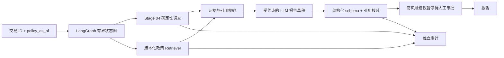

# Stage 05 实现路线：政策 RAG 与受控调查 Agent

> 状态：In Progress；路线 0 已通过，下一步路线 1 政策语料与出处
> 对应总纲：[stage-05-rag-agent.md](stage-05-rag-agent.md)
> 配套学习：[stage-05-learning-roadmap.md](stage-05-learning-roadmap.md)
> 预算：Week 6～7 共约 44 小时，其中实现、测试、复盘约 30 小时，穿插学习约 14 小时

## 1. 本阶段要交付什么

Stage 04 已有五个类型化工具、确定性调查报告、图证据和独立审计。Stage 05 在它们之上增加**可追溯政策知识**和**有限状态 Agent**：输入交易 ID 与明确的政策适用日期，先获得原有交易/模型/关系证据，再检索有效政策，生成带证据 ID 的结构化调查建议；高风险建议停在人工审批点。无证据、模型不可用或审批未完成时，系统必须明确表达状态，不能补造政策结论或执行处置。

Stage 05 的“Agent”是能处理检索、证据、失败和审批分支的受控工作流；不开放任意工具、自造 SQL 或自动封禁。Stage 06 才交付完整 API、工作台和 50 案例 MVP；Stage 07 才实现跨进程持久会话和正式 pgvector 基础设施。本阶段只验证本地检索接口和同进程的检查点暂停/恢复。

## 2. 开工前冻结的契约

| 主题 | 计划规则 | 为什么 |
|---|---|---|
| 政策语料 | 首版以明确标注的模拟企业政策为主；公开材料如加入，逐份记录 URL、许可、抓取时间和版本 | 不把公开资料冒充真实企业内部规则，也避免来源不明的版权材料 |
| 政策时间 | 请求显式携带 `policy_as_of`；政策的生效/失效日期据此筛选 | IEEE-CIS 的交易日期是人工锚点，不能直接推断真实政策适用日期 |
| 稳定引用 | 每段保留 `doc_id`、`version`、`section`、`chunk_id`、页/段位置、内容哈希和来源 | 引用能回到准确版本和片段；重建索引可核对 |
| 检索 | 统一 `Retriever` 契约；先用现有 scikit-learn 做确定性词法基线，再在路线 0 可行性门禁后加入本地 embedding | 有可运行的离线基线，并能清楚衡量 dense retrieval 的增量 |
| 模型 | 测试使用确定性 fake provider；真实演示优先本地小模型，必要时使用已授权的小额 API，均经统一适配器 | 单元测试不依赖网络、费用或随机模型输出 |
| Agent 权限 | Stage 04 工具与政策检索在 allowlist 中；LLM 只能提出有限、类型化的查询和报告草稿 | 事实查询、引用校验和审批由代码控制 |
| 审批 | 高风险建议在 `interrupt` 前冻结待审内容；批准/拒绝仅改变建议状态，不触发外部封禁/支付/邮件 | Stage 05 验证审批语义，不接入真实处置系统 |
| 数据与隐私 | 原始 IEEE-CIS、密钥、私有模型和运行报告不入 Git；日志仅记录 ID、状态、版本、延迟、Token/费用 | 沿用前四阶段的数据边界 |

版本选择、嵌入模型、生成模型、量化方式、上下文窗口和本地服务协议**不在计划阶段猜定**；路线 0 必须在当前 6GB 显存、内存和仓库内 uv 环境中验证后记录。新依赖需锁入 `uv.lock`，不能只改全局 Python。无真实可用生成端时不得把 fake-provider 测试当作已完成 LLM 验收。

## 3. 两周节奏与交付预算

| 路线 | 核心结果 | 总时间 | 其中学习 | 依赖 | 建议周次 |
|---|---|---:|---:|---|---|
| 0：前置门禁与实验契约 | 模型/依赖可行性、冻结输入输出与预算 | 3h | 1h | Stage 04 | Week 6 |
| 1：政策语料与出处 | 可公开的模拟政策、版本/时效契约 | 5h | 1.5h | 0 | Week 6 |
| 2：切分、索引和检索工具 | 可重建本地索引、词法与本地语义检索 | 6h | 2h | 1 | Week 6 |
| 3：检索评估 | 固定问答集、Recall@K 和错误分析 | 4h | 1.5h | 2 | Week 6 |
| 4：有界 LangGraph 骨架 | 复用 Stage 04 工具、显式状态/边/终止 | 6h | 1.5h | 3 | Week 6 |
| 5：结构化报告与引用核验 | 模型草稿、证据绑定、无证据降级 | 6h | 2h | 4 | Week 7 |
| 6：人工审批 | 暂停、恢复、拒绝和无副作用保证 | 4h | 1.5h | 5 | Week 7 |
| 7：可靠性与首批 Agent 评估 | 有界重试/超时、注入与费用测试 | 6h | 2h | 6 | Week 7 |
| 8：端到端验收与交接 | 真实演示、全量回归、复盘和 Stage 06 输入 | 4h | 1h | 7 | Week 7 |
| **合计** |  | **44h** | **14h** |  | **Week 6：24h；Week 7：20h** |

路线顺序是门禁，不按日期硬推进。每条路线结束时更新 [Stage 05 总纲](stage-05-rag-agent.md) 的任务、证据、决定和计划偏差；跨阶段影响才更新 `PROJECT_PLAN.md`。每天保留 30～60 分钟学习，用当日代码或失败例子做练习，不先看完课程再动手。

## 4. 路线 0：前置门禁与实验契约

**实现目标。** 核对 Stage 04 正式模型、图、五工具与失败状态；定义 Stage 05 配置草案、请求/报告/审计边界和模型预算。评估当前仓库尚未安装的 LangGraph 与本地 embedding/生成能力，记录版本、安装来源、许可证、设备、加载内存、一次短请求的延迟和结构化输出是否可用。锁定 Python 3.11 与 uv；联网安装只在此路线经验证后发生。若本地生成不足，再启用既有授权范围内的小额 API，先设本阶段费用上限和停止阈值。

**学习任务（L0，1h）。** 画出“Stage 04 确定性证据 → 政策检索 → 草稿 → 校验 → 审批”的信任边界；读 LangGraph StateGraph、持久化与中断的官方文档，区分同进程恢复和跨进程持久化。

**验收与证据。** 配置对来源、路径、预算、模型版本和无效参数给出可行动错误；CPU 可运行；fake provider 的离线最小状态图可启动；至少一个真实生成端完成短 smoke，或明确阻塞而不进入后续 LLM 门禁。记录依赖锁、显存/内存、延迟、费用估算和采用/降级决定。

**2026-09-24 执行结果：Done。** 已冻结[实验与信任边界契约](../data/stage-05-experiment-contract.md)；正式 Stage 04 调查五工具均为 `ok`。LangGraph 1.2.12 已锁定并通过 fake `StateGraph`；Ollama 0.33.2 与 `qwen2.5:0.5b` 经 digest 核对和真实 JSON smoke；配置绑定精确摘要、loopback endpoint 与预算。聚焦 22 项、全量 188 项测试通过，详见[路线 0 门禁记录](../../reports/stage-05-route-0-preflight.md)。该模型仅作为 smoke 候选，政策结论质量和引用约束仍由后续路线验收；本地 embedding 尚未验证，路线 2 先保留词法基线。

## 5. 路线 1：政策语料与出处

**实现目标。** 建立至少 8 份短小、明确标注“模拟”的风控政策，覆盖设备共享、交易速度、人工复核、例外、证据不足等情景，并故意包含一个新版取代旧版和一个相互冲突的情景。每份有稳定文档 ID、标题、版本、生效区间、所有者、来源类型、许可/可公开说明、内容哈希；可引用位置精确到章节或段。公开来源可选，但来源/许可不明时不得纳入正式索引。

**学习任务（L1，1.5h）。** 手工比较同主题两个版本，回答“2026 年某日适用哪份政策”；解释为何 IEEE-CIS 人工锚点不能代替 `policy_as_of`。

**验收与证据。** 重复导入产生相同文档顺序和哈希；无效日期、重叠有效版本、缺来源或重复 ID 明确失败；语料与来源清单可独立阅读。文档内恶意指令只作为测试夹具，不成为系统指令。

## 6. 路线 2：切分、索引和检索工具

**实现目标。** 按章节/段落切分，避免把一条完整条件拆碎；`chunk_id` 随文档版本、章节、位置和文本哈希稳定生成。构建可重建的本地词法索引；在路线 0 通过后加入本地 embedding 检索，固定模型版本/维度与向量归一化。统一 `retrieve_policy(query, policy_as_of, top_k)` 结构化输出：片段、分数、出处、版本、生效范围、索引版本和错误码。检索前按生效区间过滤；并列分数以稳定 ID 排序。pgvector 只写接口映射计划，正式接入属于 Stage 07。

**学习任务（L2，2h）。** 手算一次“切分 → 词法匹配 → 语义候选 → 时效过滤 → 排序”；比较过小/过大 chunk 如何影响召回和引用精度。

**验收与证据。** 同一语料两次构建的 manifest/ID/排序一致；过期政策、错误版本、空查询、无命中、损坏索引及模型维度错配都有结构化结果；无命中不能伪造片段。若本地 embedding 未过资源门禁，保留已评估词法检索并在总纲记录降级，不能声称完成 dense 检索。

## 7. 路线 3：检索评估

**实现目标。** 在写生成提示前，先冻结至少 24 个政策查询案例，包含可回答、无答案、版本冲突和同义改写；标注期望 `chunk_id`、`policy_as_of` 与拒答原因。开发集可调切分/检索权重，保留独立冻结集做最终核对。报告 Recall@1/3/5、MRR、无答案误召回率、旧版误引率、查询延迟及各类失败明细。不要仅报告一个平均分。

**学习任务（L3，1.5h）。** 对两个手算案例求 Recall@3 与 MRR；解释“召回了相关文档”为什么仍不等于“回答受证据支持”。

**验收与证据。** 冻结集中可回答案例的 Recall@3 目标至少 0.80，过期/无答案案例不得产生可用于政策结论的引用。若未达标，记录失败样本并回到开发集改进，重新版本化评估集；不能删除难例或在冻结集上反复挑参数。

## 8. 路线 4：有界 LangGraph 骨架

**实现目标。** 定义小而可序列化的状态：请求、`policy_as_of`、Stage 04 调查结果、政策检索结果、草稿、校验结果、错误、步骤数、审批状态；构建显式节点与条件边。优先复用 Stage 04 的 `InvestigationWorkflow`，不复制其 SQL/图查询逻辑；交易不存在则终止，图能力部分失败仍可进入有标记的后续节点。工具计划只能从 allowlist 选取，任何新工具或参数都经 Pydantic 校验。保留固定调用上限与终止节点；先用 fake provider 跑通全流程。

**学习任务（L4，1.5h）。** 手绘三个状态转移：正常调查、图未覆盖、政策无命中；说明哪一步由模型提出，哪一步由代码裁决。

**验收与证据。** 对相同 fixture 的节点顺序、选择和终止状态稳定；不允许循环越过上限、跨数据源混用、把 `partial` 当作完整证据；Stage 04 的 166 项旧回归仍通过。

## 9. 路线 5：结构化报告与引用核验

**实现目标。** 经统一 provider adapter 调用真实模型，要求草稿符合 Pydantic 报告 schema：交易事实、模型分数、图线索、政策结论、逐条 `chunk_id` 引用、不确定性和建议动作。代码核验每个引用确实来自本次可用且当前有效的检索片段，并校验交易/模型证据 ID。证据不足时强制输出“无法依据现有政策判断”，不能以模型常识补写。保留 Stage 04 原始报告与独立审计，Agent 只生成派生报告；模型 prompt/version、Token、费用和延迟进入审计元数据。

**学习任务（L5，2h）。** 对一个正常引用、一个旧版引用和一个“凭空编造规则”草稿逐条判定；区分“引用存在”与“句子受到引用支持”。

**验收与证据。** 结构非法、伪造 chunk ID、引用旧版、模型超时、无政策证据均有失败/降级测试；至少一条真实模型输出通过 schema 和引用校验。人工复核固定样例中的政策结论，发现无依据的关键结论即失败并修正；只通过结构检查不算完成语义验收。

## 10. 路线 6：人工审批

**实现目标。** 对高风险建议设置 LangGraph `interrupt`：暂停并提供待审报告哈希、交易 ID、建议动作、证据摘要和审计 ID。恢复时要求同一会话 ID、同一待审版本和明确批准/拒绝；重复提交保持幂等，修改报告后旧审批无效。批准/拒绝只更新建议状态；此阶段没有外部处置工具。使用开发用检查点验证同进程暂停/恢复；跨进程持久检查点与工作台集成归 Stage 07/06。

**学习任务（L6，1.5h）。** 画出 pending、approved、rejected、expired 四个状态；解释为什么恢复时可能重新运行中断节点，以及节点前不能放不可重复的副作用。

**验收与证据。** 未批准、拒绝、过期、错会话、错哈希、重复恢复都不能变成“已执行处置”；正常批准与拒绝可在同进程恢复且审计完整；任何路径都没有真实封禁、支付或发送动作。

## 11. 路线 7：可靠性与首批 Agent 评估

**实现目标。** 对暂时性模型/检索错误设置有限重试和超时，对输入、schema、来源错误直接终止；冻结最大步骤、模型调用和费用阈值。建立首批至少 12 个 Agent 案例，覆盖正常、无证据、旧版、注入文本、模型不可用、图部分失败、审批通过/拒绝、超时与重试。离线 fake provider 保证回归可重复；真实 provider 仅做有预算的抽样。评估工具选择/参数、引用完整性、无依据结论、分支正确率、延迟、Token 和估算费用。

**学习任务（L7，2h）。** 为每个失败标注“可重试、需用户补充、应终止”；读一条完整审计并找出延迟和费用集中在哪个节点。

**验收与证据。** 固定案例的结构化分支与审批安全性全部通过；引用 ID 必须属于本次允许集合；语料中的 prompt injection 不能改写系统工具计划或审批状态。真实模型输出不稳定时保留原始失败案例和预算记录，不能只展示成功截图。

## 12. 路线 8：端到端验收与复盘

**实现目标。** 对预先选定的真实 IEEE-CIS held-out 交易完成“Stage 04 证据 → 政策检索 → 结构化报告 → 待审批/拒绝”的一次演示；再展示无证据和依赖失败分支。运行聚焦/全量测试、离线可执行 smoke、包构建、受限文件检查。报告语料规模/版本、检索指标、Agent 案例结果、真实 provider、Token/费用/延迟、审批状态、限制与 Stage 06 输入。

**学习任务（L8，1h）。** 准备 90 秒解释：为什么这是有边界的 Agent、政策结论如何追溯、失败如何恢复、哪些部分仍未达到生产要求。

**完成门禁。** [Stage 05 总纲](stage-05-rag-agent.md)的验收标准逐条附证据后才改为 `Done`。若真实生成端、检索质量、引用真实性或审批安全性未达标，保持 `In Progress` 并记录可执行修复；不要用 fake provider 或删减测试掩盖缺口。

## 13. 官方参考与使用边界

- [LangGraph StateGraph](https://docs.langchain.com/oss/python/langgraph/use-graph-api)：状态、节点与条件边；实施时以锁定版本的可运行 API 为准。
- [LangGraph interrupts](https://docs.langchain.com/oss/python/langgraph/interrupts)：暂停、检查点、同一 thread ID 恢复；中断节点在恢复时会从节点开头重跑。
- [LangGraph thinking in graphs](https://docs.langchain.com/oss/python/langgraph/thinking-in-langgraph)：错误分类、有限重试和可恢复节点。
- [LangChain semantic search](https://docs.langchain.com/oss/python/langchain/knowledge-base)：文档切分、embedding、向量检索和分数解释；本项目的稳定引用与评估契约由自身代码负责。

这些链接用于理解概念和核对现行接口，不能替代路线 0 的本机版本、资源和许可门禁。
