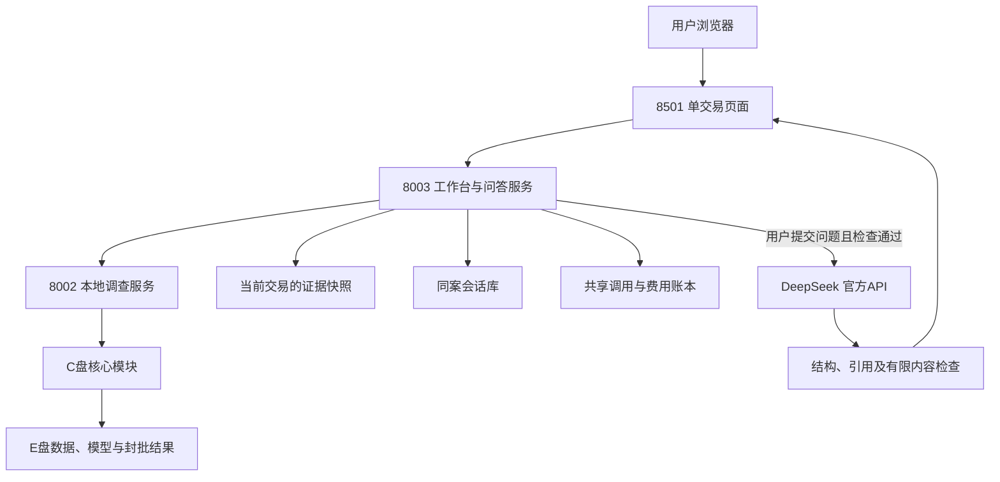

# GraphRisk-Agent 项目结构与 Agent 接手说明

用途：供其他 Agent 审查、定位和修改项目时建立正确的工程认识。结构核对日期：2026-11-18。

**先读 [AGENTS.md](../AGENTS.md)，再读 [CURRENT.md](../CURRENT.md)，随后读本文。CURRENT 是当前采用版本、下一步和暂停条件的唯一摘要入口；本文解释结构、成果的含义和定位方法，不维护另一份实时进度、PID或剩余额度。** 运行入口改变后，应同步修订本文相关结构，旧日期材料不自动覆盖当前入口。

## 1. 项目要解决什么问题

GraphRisk-Agent 是面向求职展示的交易欺诈调查 Agent 项目，使用 IEEE-CIS 数据研究风险排序，并把交易事实、机器学习评分、关系图线索和政策资料组织成可追溯的调查结果。系统帮助人判断调查优先级、理解依据和确定下一步核实事项。

需要区分三个结果：

| 结果 | 主要来源 | 正确理解 |
| --- | --- | --- |
| 交易风险分数及高／中／低分档 | XGBoost 与分档策略 | 调查优先级，不是已确认欺诈或已校准欺诈概率。 |
| 数据事实及关系证据 | 结构化数据、本地工具、封批记录 | 区分已取得、缺失、未测量；共享匿名字段不证明同一客户。 |
| 报告与自然语言回答 | DeepSeek 加证据合同、引用检查及程序展示 | 模型解释和假设仍可能出错，建议不代表已经执行。 |

项目包含数据、模型、图、Agent、评估和界面多层；网页聊天框只是其中一个入口。当前问答不会自动封卡、拒付、冻结账户或执行业务处置。

## 2. 先回答“哪一个是主项目”

**这是一个项目，但当前运行版本由两处源码和一组本地适配代码共同组成，尚未收敛为一个可以独立运行的源码根目录。** 不要因为终端位于 E 盘，就假设加载的是 E 盘同名 `src`；也不要只审查 C 盘就认为已覆盖当前网页。

| 位置 | 当前实际职责 | 接手时如何使用 |
| --- | --- | --- |
| [E 盘项目根目录](E:/GraphRisk-Agent) | 当前工作目录；CURRENT、活跃文档、环境、数据、模型、扩展、状态库和执行证据。 | 当前任务从这里进入。 |
| [C 盘工作树](C:/Users/12138/.codex/worktrees/71df/GraphRisk-Agent) | 当前运行导入的核心 `graphrisk` 应用代码基线。 | 修改核心模块前核对这里的 AGENTS 和实际导入路径。 |
| [单交易工作台扩展](E:/GraphRisk-Agent/extensions/transaction_workbench) | 当前网页、问答服务和累计预算的直接入口。 | 网页、交易到证据的适配、问答接入先从这里定位。 |
| [原调查服务适配目录](E:/GraphRisk-Agent/artifacts/agent-trial-20261115-2u0xpeep/live) | 8002调查后端的实际启动代码及适配依赖。 | 名称虽在 artifacts 下，当前仍参与运行，不能当普通缓存清理。 |
| [旧问答扩展](E:/GraphRisk-Agent/extensions) 中的 `case_qa_*` | 多轮试验和冻结实现；其中部分仍被当前扩展导入。 | 根据 import 和配置绑定判断用途，不按版本号或目录时间选“最新版”。 |
| E 盘同名 `src/graphrisk`、`api` 等 | 另有源码内容，不能自动视为当前核心基线。 | 合并前做逐项差异核对，不以同名目录相互覆盖。 |

已按当前启动器的 `PYTHONPATH` 实测：`graphrisk`、`graphrisk.agent.autonomous_budget`、`graphrisk.serving.daily_conversation_backend` 来自 C 盘工作树；`extensions.transaction_workbench.runtime` 来自 E 盘。此结论针对该启动环境；换终端、启动命令或环境后需要重新核对。

## 3. 三个服务如何组成一个应用

| 端口 | 服务 | 实际入口 | 职责 |
| --- | --- | --- | --- |
| 8501 | Streamlit 页面 | [web.py](E:/GraphRisk-Agent/extensions/transaction_workbench/web.py) | 同一交易的风险与证据、报告、直接提问。 |
| 8003 | 工作台／问答 FastAPI | [runtime.py](E:/GraphRisk-Agent/extensions/transaction_workbench/runtime.py) | 交易目录适配、本地会话、证据绑定、问答路由及预算接口。 |
| 8002 | 本地调查 FastAPI | [serve_live_trial_recovery.py](E:/GraphRisk-Agent/artifacts/agent-trial-20261115-2u0xpeep/live/serve_live_trial_recovery.py) | 已封批风险结果、本地调查证据及原报告适配能力。 |



DeepSeek 在云端运行，8003不是本地运行的一份DeepSeek模型。启动器、uv和PowerShell可能还有包装进程；定位应用时看监听端口、命令行和入口文件，PID只对当前进程生命周期有效。

当前默认页面读取已封批的日终评分。选择交易或提问不等于重新训练XGBoost，也不等于交易发生当时的即时评分。通用命令 `uvicorn api.main:app --port 8000` 不代表已启动这套工作台。

## 4. 当前链路具体做了什么

### 4.1 选择交易与查看报告

1. 页面向8003读取封批交易目录。
2. 8003通过 `Catalog` 向8002查询封批元信息和本地调查结果，核对批次修订及内容身份。
3. 将本案证据适配为问答事实卡，保存本地快照；原问答案例可复用已冻结的证据绑定。
4. 展示本笔交易的程序证据报告，或符合绑定／事实一致性条件的已存DeepSeek稿件。
5. 恢复该交易已有会话，供阅读和后续提问。

**打开页面、选择交易、查看已有报告和刷新记录不会自动请求DeepSeek。** 当前页面没有把每次打开报告变成一次付费新报告生成。原调查后端的报告生成能力与当前自由问答是不同用途，不能混用两套调用许可。

历史首稿有可能与当前证据的查询ID不同。工作台的 `same_report_facts` 用于显示层核对：交易、评分封批上下文、事实指标／数值／缺失／时间范围／模型及政策必须一致，允许查询身份字段变化。它不把历史稿件重新判为通过，也不将历史报告自动当成新问答事实。

### 4.2 用户向 DeepSeek 提问

1. 服务端绑定当前交易及证据版本，检查问题和父轮次。
2. 从本案成功问答中选择有限历史；原始事实来自证据，而不是历史回答。
3. 共享账本先检查累计次数、费用、未知预约和授权，再持久化单次请求占位。
4. 调用一次DeepSeek，保存原始响应、身份、usage与费用估算；不自动重试或修复。
5. 检查返回结构、案例和证据版本、引用，以及部分数字／断言信号。
6. 分别展示程序事实、DeepSeek解释、待核实假设和核实建议；失败或待复核原文单独保留。

当前专用问答主要复用已有本案证据，**不是每轮聊天都重新运行一次完整自主调查、图检索和政策搜索**。项目其他模块存在完整调查工作流，不代表当前聊天框已经接通其所有行动能力。

关键限制和实际余量读取[当前入口](../CURRENT.md)及服务端状态。会话存储上限、最近历史轮数、上下文字节、费用预约和当日核价分别属于不同约束；不能只把界面显示的次数改大，就宣称后端已扩额。

## 5. 已有成果与验收边界

以下是能力地图；采用版本和剩余工作以CURRENT的实时摘要为准，具体实验结果读对应原件。

| 方向 | 已有成果／当前使用方式 | 尚不能据此声称 |
| --- | --- | --- |
| 数据与特征 | 时间切分、历史行为与关系特征、训练类别映射、即时／日终／比赛回顾口径，以及封批和迟到处理已有工程实现与实验。 | 匿名字段的真实业务到达时间已逐项得到证明，或比赛回顾结果可直接用于即时场景。 |
| 风险排序 | 日终XGBoost 216+49用于当前默认工作台；即时增强模型保留扩展，原x3保留回退。 | 这是所有可能模型中的全局最优，或误报和漏报已经解决。模型采用及评估依据见[路线6记录](plans/route6-model-selection-20261105.md)、[champion计划](../champion改造计划.md)及CURRENT。 |
| 图关系 | 有图模型、关系查询和结构化图证据能力。 | 每笔交易都存在独立图评分；没有分数不能填零，关系线索不能当欺诈事实。 |
| 主报告／路线五 | 用户认可过日终v12 quotes-v2与精简呈现；旧首稿、引用和检查结果保留。 | 所有新稿自动通过，或问答的写作质量已经一并验收。 |
| 参考资料／路线七 | 查询规划、资料支持／拒答、精简附录及边界测试有工程与执行证据。 | 所有政策资料都是真实业务规则，或资料适用条件已在本案成立。 |
| 评审／路线八 | 受控错误、片段及全文评审有实验记录。 | 全文评委已合格，或可以自动替代人的验收。 |
| 完整案例／路线九 | 双模型案例评估已有执行结果及中断恢复记录。 | 全部样本、重复和两模型评估已完成；当前暂停条件仍须保留。 |
| 自由问答与工作台 | 服务端会话、专用证据合同、预算、单页交互及历史真实调用已有证据。最近单页改造有[18项离线检查与浏览器核验](../reports/transaction-workbench/VERIFICATION.json)。 | 新页面等于新一轮生成质量验证；该18项检查不是全项目全量回归。 |

特别注意：旧文档里的 Stage 00～10 与 Agent 升级专项内部“路线五、六、七、八、九”是不同层次的编号。不能据旧Stage索引的Done推断当前升级路线已经验收完成。[总体计划](../PROJECT_PLAN.md)是目标和历史规划；[阶段索引](plans/README.md)不是实时状态表。

## 6. 按修改目的定位源码

| 任务 | 优先查看 |
| --- | --- |
| 页面布局、选择交易、提交与刷新状态 | [工作台web.py](E:/GraphRisk-Agent/extensions/transaction_workbench/web.py) |
| 封批交易到问答证据、报告展示适配、会话恢复 | [工作台runtime.py](E:/GraphRisk-Agent/extensions/transaction_workbench/runtime.py) 的 `Catalog`、`build_app`、`saved_draft_text`、`same_report_facts` |
| 当前问答预算及历史账本认证 | [工作台budget.py](E:/GraphRisk-Agent/extensions/transaction_workbench/budget.py) 的 `WebBudget` |
| 问答构包、历史选择、幂等占位、原文保存 | [CompactService](E:/GraphRisk-Agent/extensions/case_qa_compact_v1/service.py)、[会话基线](E:/GraphRisk-Agent/extensions/case_qa_v1/sessions.py) |
| 问答返回结构、引用和内容检查 | [紧凑回答合同](E:/GraphRisk-Agent/extensions/case_qa_compact_v1/contract.py)、[证据合同](E:/GraphRisk-Agent/extensions/case_qa_v1/evidence_contract.py) |
| DeepSeek单次运输、响应身份、费用结算 | [正式运输基线](E:/GraphRisk-Agent/extensions/case_qa_live_v2/budget.py)、[C盘provider工具](C:/Users/12138/.codex/worktrees/71df/GraphRisk-Agent/src/graphrisk/agent/autonomous_providers.py) |
| 日批特征与评分、封批、迟到数据、模型分档 | C盘serving下的[champion_daily_batch.py](C:/Users/12138/.codex/worktrees/71df/GraphRisk-Agent/src/graphrisk/serving/champion_daily_batch.py)、[daily_batch_store.py](C:/Users/12138/.codex/worktrees/71df/GraphRisk-Agent/src/graphrisk/serving/daily_batch_store.py)、[day_batch_bands.py](C:/Users/12138/.codex/worktrees/71df/GraphRisk-Agent/src/graphrisk/serving/day_batch_bands.py) |
| 原调查API和日终证据生成 | [8002适配入口](E:/GraphRisk-Agent/artifacts/agent-trial-20261115-2u0xpeep/live/serve_live_trial_recovery.py)、[原适配实现](E:/GraphRisk-Agent/artifacts/agent-trial-20261115-2u0xpeep/live/serve_live_trial.py)、[daily_conversation_backend.py](C:/Users/12138/.codex/worktrees/71df/GraphRisk-Agent/src/graphrisk/serving/daily_conversation_backend.py) |
| 完整Agent调查、工具执行与证据 | C盘 `src/graphrisk/agent`、`investigation`；按需求继续定位，不从当前QA界面推断全链路。 |
| 数据、训练与图研究 | C盘 `src/graphrisk/data`、`features`、`training`、`models`、`graph`；具体实验从CURRENT和对应计划进入。 |
| 启动失败、导入错版本 | [新启动器](E:/GraphRisk-Agent/scripts/start_transaction_workbench.ps1)、[8002启动器](E:/GraphRisk-Agent/artifacts/agent-trial-20261115-2u0xpeep/start-recovery.ps1)及当前进程命令行。 |

当前工作台还复用了旧扩展中的显示函数，因此修改显示时要沿实际import继续追踪。上表是定位入口，不是“这些文件都可以直接覆盖”的许可；部分文件处在冻结哈希绑定中。

## 7. 运行状态、模型和历史材料分别在哪里

| 类型 | 位置／读取方法 | 维护原则 |
| --- | --- | --- |
| 当前工作台配置 | [reports/transaction-workbench/config.json](E:/GraphRisk-Agent/reports/transaction-workbench/config.json) | 包含批次、模型身份、绑定源码和输出位置；以内容为准，不从日期目录推断。 |
| 共享次数与费用账本 | `E:\GraphRisk-Agent\reports\generated\agent-investigation-upgrade\live-budget.sqlite3` | 问答、旧报告和评估共用历史；不能清空或通过新建会话重置。 |
| 当前QA会话库 | `E:\GraphRisk-Agent\reports\transaction-workbench\conversations.sqlite3` | 保存对话和状态，不是费用账本；与旧原始会话库分开。 |
| 当前问答证据快照 | `E:\GraphRisk-Agent\reports\transaction-workbench\cases` | 与选定交易和证据版本绑定，不能互相冒用。 |
| 执行原文、授权、回执、评估 | E盘 `reports` 下对应具体用途目录；由CURRENT链接 | 历史事实继续原位保留，失败、待复核、未知与成功均不能覆写。 |
| 模型与类别映射 | 当前评分配置、封批元信息和[模型保留记录](plans/route6-model-selection-20261105.md)所指文件 | 权重、特征顺序、类别映射、时间口径、分档策略和哈希应一起核对，不能只换模型文件。 |
| 资料用途与退役状态 | [MATERIALS.md](MATERIALS.md)、[机器清单](../reports/materials-inventory.jsonl) | 历史证据不等于无用文件；目录旧不等于可删除。 |

余额、调用次数、价格核验日期、未知预约和暂停原因会变化，应从CURRENT和账本／状态接口核实，本文不抄录余量。历史网页报告许可与当前自由问答许可各自保留；保留的路线九额度也不能挪作自动网页测试。

启动与查看默认不需要取得新的外发许可。实际发送仍要满足相应用途、证据范围、费用和次数约束；不要反复索取已经覆盖本次操作的授权，也不要把本文当作新增外发、扩额、删除或恢复暂停评估的授权。

## 8. 其他 Agent 应怎样安全地开始审查或修改

1. **明确范围。** 先确定用户要改页面、问答、核心调查还是模型。查CURRENT与相关源码即可，不全量阅读历史报告。
2. **确认真实运行版本。** 核对端口、启动脚本、工作目录及导入路径。先检查两个目录各自的未提交修改和本地文件，不能只靠Git提交日期判断源码新旧，不回退用户已有修改。
3. **先定位合同和测试。** 识别证据schema、预算账本、配置中的`files`绑定及历史回执依赖；不要为修界面而关闭预算或引用检查。需要调整绑定时保留旧执行版本和恢复依据，按实际变更接续，不把历史审计要求变成无限增加适配目录的理由。
4. **保持改动最小。** 后续代码设计与实现遵循用户要求的Ponytail工作流；复用现有依赖。本说明不引入新框架，不要求额外Agent并行，也不要求发PR或提交用户现有改动。
5. **做有意义的离线检查。** 工作台主要流程直接使用TestClient和MockTransport，页面保留一个AppTest提交冒烟；只读健康查询不能冒充真实生成质量验证。修改后根据范围选择测试，不为文档或收尾启动训练、付费模型或本地4B。
6. **按仓库规则收尾。** 只同步受影响的CURRENT、活跃计划、使用说明和资料清单；结构未变时不抄一份“最新状态”。发现未完成或失败就如实记录，不能以测试数量替代验收。

环境使用Python 3.11和uv；每个新PowerShell进程先初始化项目环境。当前实际启动命令直接使用[CURRENT的启动说明](../CURRENT.md#2-当前怎么启动)，避免在本文复制另一套启动步骤。

复用现有环境运行工作台相关测试的示例：

```powershell
Set-Location -LiteralPath 'E:\GraphRisk-Agent'
. .\scripts\enter_project_env.ps1
$env:PYTHONDONTWRITEBYTECODE = '1'
$env:PYTHONIOENCODING = 'utf-8'
$env:PYTHONPATH = 'E:\GraphRisk-Agent;E:\GraphRisk-Agent\artifacts\agent-trial-20261115-2u0xpeep\live;C:\Users\12138\.codex\worktrees\71df\GraphRisk-Agent;C:\Users\12138\.codex\worktrees\71df\GraphRisk-Agent\src;C:\Users\12138\.codex\worktrees\71df\GraphRisk-Agent\scripts'
$env:PYTEST_DISABLE_PLUGIN_AUTOLOAD = '1'
# 保留已定内存保护；依赖已同步时复用环境，不在此自动安装或升级依赖。
uv run --offline --no-sync pytest tests/unit/test_transaction_workbench.py tests/unit/test_transaction_workbench_regression.py -q
```

这条命令保留原16项API／合同检查，新增回答后刷新／切换交易的API检查及一个页面提交冒烟。原文件中的两项UI检查在替代文件同时参与收集时明确计为`2 deselected`，并非通过或跳过；单独指定原文件仍可运行原用例。原文件处在142项运行绑定中，保持原字节；替代测试和限定夹具位于[新测试](../tests/unit/test_transaction_workbench_regression.py)与[测试配置](../tests/unit/conftest.py)。

离线工作台夹具将可用内存固定为4 GiB，专门的低内存用例再设为1 GiB，以免电脑负载决定模拟调用能否发送。生产2 GiB保护没有改动。AppTest只提交一次，关闭TestClient并在前后清理Streamlit缓存；刷新、交易切换、重放、多轮及预算边界由API层验证。冒烟失败会附实际HTTP路径、响应码及页面错误，不能仅凭“调用0次”就断言AppTest丢提交；也不以自动重试或“连跑至通过”充当门禁。

查询 `GET /health`、`GET /api/v1/workbench/status` 和已存会话属于只读检查；向 `/api/v1/case-qa/conversations/{id}/turns` 提交问题可能实际消费付费调用，不能当健康探针。

## 9. 已知问题与工程收敛方向

接手时优先检查这些边界，实时优先级仍以用户最新任务和CURRENT为准：

- 两处源码、试用目录依赖及跨进程调用增加了部署、排错和审查成本；网页合并不等于后端和源码已经合并。
- 当前聊天仍可能冗长、重复；旧回答中“只共享邮箱域”的排他含义没有充分逐条证据支持。旧否定句也曾被检查器误报，不能把合同通过当完整语义正确。
- 会话恢复、证据缓存、过期策略和跨会话上下文需要结合实际请求审查；导入空会话曾遮住有内容的记录，原库与[排除副本的恢复记录](../reports/transaction-workbench/EMPTY-ARCHIVE-COPIES.json)保留。
- 当前配置绑定具体已封批次；能打开现有案例不代表任意新交易、新日期或真实业务数据已经自动接入。
- 模型排序、分群误报／漏报、字段可用时点和全文评委质量仍各有独立验收要求。

最近提出的工程收敛目标是：**一套正式源码、网页与统一后端两个服务、一个管理启动／状态／关闭的入口。** 可考虑以E盘作为统一工程目录，先核对C盘独有修改，再迁移调查与问答能力。该方向在本文编写时仍是建议，尚未执行；本次用户要求的是说明文档，不构成迁移或合并已完成的证明。

若后续获得实施任务，先形成可回退的差异与依赖清单，复用现有模型、证据合同、报告和账本，在离线等价性检查通过后切换运行入口。验收应证明只加载一处正式源码、旧案例输出与状态可恢复、预算和未知请求保护仍有效，以及原模型回退可用；不能只把两个端口号改成一个就宣布收敛完成。

## 10. 接手时的最小阅读清单

| 目的 | 阅读顺序 |
| --- | --- |
| 了解项目与当前成果 | AGENTS → CURRENT → 本文 → 按需查看总体计划。 |
| 修改当前网页／问答 | CURRENT → [自由问答计划](plans/DeepSeek自由问答改造计划.md) → 本文第6节对应代码与测试。 |
| 修改模型／日批口径 | CURRENT → [champion计划](../champion改造计划.md) → 对应训练、特征、评分与分档记录。 |
| 改善报告质量 | CURRENT的主报告与路线五条目 → 对应已认可稿件、原证据与检查器 → 区分生成缺陷和检查器缺陷。 |
| 接续完整案例评估 | CURRENT的路线九条目 → 原执行／暂停／预算协议，不从旧脚本自动续跑。 |
| 清理或迁移目录 | CURRENT → [资料状态索引](MATERIALS.md) → 配置绑定、直接引用及恢复依据。 |

遇到说明与实际代码、配置、账本或用户最新要求不一致时，定向核验并更新相关说明；不要用本文替代执行证据，也不要为“确认现状”自动触发新付费请求。
